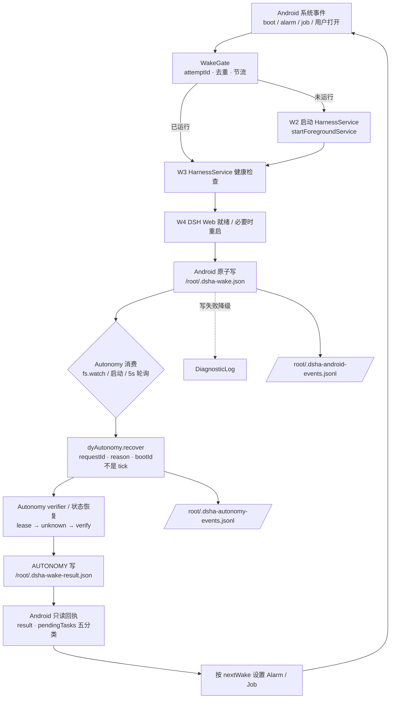

# ANDROID-REPORT-0002 · Android 平台负责人报告（平台能力契约 + 后台恢复设计 v2）

> 会话：Android 平台负责人（DSHA Android 平台专业智能体）
> 覆盖任务：`ANDROID-ARCH-AUDIT-01`、`ANDROID-BACKGROUND-RECOVERY-DESIGN-01`、`ANDROID-BACKGROUND-RECOVERY-DESIGN-02`
> 迭代规则：本文件覆盖式更新、版本号递增（ANDROID-REPORT-0003…），不新增同类文件；与 `coordination/HANDOFF.md`、`coordination/REPORT.md` 同目录。
> 最近更新：2026-11-21 09:55 (Asia/Shanghai) · v2 按 GPT 12 项裁决修订
> 性质：只读设计修订。未改 DSHA 源码/Manifest/服务/配置/权限；未装包、未部署、未重启、未 kill/reboot、未启动 staging/调度；未改生产库；未改共享 HANDOFF/REPORT/PROJECT；未改 Autonomy 接口。

## 版本历史

| 版本 | 时间 | 覆盖任务 | 变更摘要 |
|---|---|---|---|
| v1 (ANDROID-REPORT-0001) | 2026-11-21 02:45 | ARCH-AUDIT-01 + RECOVERY-DESIGN-01 | 首次建档：平台基线、19 项能力矩阵、权限矩阵、后台可靠性、恢复设计初稿 |
| v2 (ANDROID-REPORT-0002) | 2026-11-21 09:55 | + RECOVERY-DESIGN-02 | 按 GPT 12 项裁决修订：恢复入口去掉 tick、文件所有权表、请求消费机制、回执与 nextWake、WakeScheduler 状态机与四段分离、事件日志拆分、能力契约与失败码固化；同步 Autonomy 报告 v1 的两处差异 |

---

## 0. 给 GPT 的阅读导航（先看这一节）

**本轮修订的 8 个要点**
1. **恢复入口改为 `dyAutonomy.recover({requestId, reason, bootId})`**，彻底删除「`tick({trigger:'resume'})`」——tick 可被关闭，恢复不能依赖它（对应 §3.2/§3.6）。
2. **文件所有权唯一**：5 个文件各只有一个写入方，禁止两个模块写同一个 JSONL（§3.3）。
3. **请求消费机制**补齐 8 个问题：运行时通知、启动统一、半写入、去重、过期、恢复中合并、回执判定（§3.6）。
4. **回执 + nextWake 契约**：`pendingTasks` 拆成 5 类；`nextWake` 由 Autonomy 建议、Android 执行（§3.7）。
5. **四段分离**：唤醒 Android 进程 / 启动 Harness / 启动 DSH Web / Autonomy 恢复，各自记录状态与错误码，不再合成一步（§3.5）。
6. **事件日志拆分**：Android 独立 `/root/.dsha-android-events.jsonl`，写失败降级 DiagnosticLog，不写 Memory、不写 FUSE（§3.4）。
7. **19 项能力矩阵升级为契约**：区分「端点存在 / 可调用 / 权限允许 / 效果已验证」四级，失败码固化（§2）。
8. **跨报告一致性**：Autonomy 报告 v1 仍用共享 `runtime-events.jsonl` 与 `resumeTick`，需其 v2 同步（§5.3）。

**仍需 GPT 裁决（§5.1）**
1. `wake.json` 的消费触发落点：Autonomy 用 `fs.watch('/root')` + 5s 轮询兜底是否接受（Android 侧无跨进程调用能力）。
2. 回执轮询节奏：1s→30s 指数退避、到 deadline 停，是否接受。
3. `nextWake` 的钳制范围：Android 侧强制 `[10min, 24h]`，是否接受。
4. 事件日志轮转：2MB×2（主 + .1），是否接受。
5. Autonomy 报告 v1 的三处不一致由其 v2 修正，还是由我在 v3 里兼容。

**需负责人授权（§5.2）**
1. 安装 DSHA **test 变体 APK**；2. 真机 kill/reboot 对照实验；3. 启动 staging；4. 生产灰度与 `WakeScheduler` 开关；5. 是否把「电池优化白名单」作为长期依赖。

---

## 1. 基线（本轮重新核对，2026-11-21 09:43–09:50）

| 对象 | 值 | 核对方式 |
|---|---|---|
| `coordination/project-handoff` HEAD | `8a48e3f08a74eba861d41ff61b44e127af2c41c0` | `git fetch` + `ls-remote` 一致 |
| 本报告 blob（v1） | `ccecf1dd825271345ee25e5a8040d30840087f81` | `git ls-tree` |
| `coordination/HANDOFF.md` | `f8ffa40d4c27c04d23ff74b123bf2b7044821976`（3317 行） | 同上，本轮未改 |
| `coordination/REPORT.md` | `e219f707cc4363c53704fbe389f786148142326e`（172 行） | 同上，本轮未改 |
| `coordination/Autonomy 自主系统负责人报告.md` | `58b40bf8334c3d59918504deeaf10a74e941cd5b`（367 行，AUTONOMY-REPORT-0001） | 同上，本轮只读 |
| `DSH-APP/DSHA` main | `36d89b72294348d0482d509109cf8e76d51fc1cb` | `ls-remote`，与本轮只读克隆一致 |
| `ba-song/dsh-autonomy` main | `6c4a4753b4737060211955b1f022cab2f1d39521` | `ls-remote` |
| `ba-song/dsh-memory-core` main | `7548e49ed0b8d8673818464325d8e72ec7704b27` | `ls-remote` |
| `dsh-persona-core` main / EI-1 | `a84c7bad…` / `92a763bf…` | `ls-remote` |
| 设备 | vivo V2154A · Android 14 (SDK 34) · OriginOS 14.1 · RAM 11.1GB · 存储 105.57GB 可用 | `/app/device` 09:44 |
| DSHA / 进程 | `0.2.1-rc.2-20261022.2100` · pid 22300 · 连续运行 1d22h12m（同一 pid，未重启） | `dumpsys activity processes` 09:45 |
| 运行时 | Ubuntu 24.04.3 arm64 · PRoot `libproot.so -0 --link2symlink` · 伪 root uid 10328 · Node 24.19.0 · Python 3.12.3 | `ps` / `/proc/self/status` |

---

## 2. 能力契约与失败码（原 19 项矩阵升级）

### 2.1 四级判定（禁止把前一级写成后一级）

| 级别 | 含义 | 判定方式 |
|---|---|---|
| L1 端点存在 | 桥/文档/源码里有这个入口 | `/app/help`、源码 grep |
| L2 可调用 | 真实调用能返回结构化响应（非 404/未知） | 实测调用 |
| L3 权限允许 | Android 权限与产品开关都放行 | `dumpsys package` + 实测响应 |
| L4 效果已验证 | 产生预期副作用/数据且可观察 | 实测 + 观察 |

结论写法：`L1 PASS / L2 PASS / L3 DISABLED / L4 NOT RUN`。

### 2.2 契约表（`capability → endpoint → permission → failureCode → level`）

| # | 能力 | 端点/入口 | 关键权限 | 已知失败码 | 本轮级别 |
|---|---|---|---|---|---|
| 1 | 读屏语义树 | `/app/ui/dump` | 无障碍服务已启用 | `NO_PERMISSION` | L4 PASS（返回 `dsha-screen-tree-v1`） |
| 2 | 截屏 | `/app/ui/screenshot` | 无障碍 + 截图 | `NO_PERMISSION`/`UNKNOWN` | L4 PASS（1080×2400，displayId 0，`coordinatesAvailable:true`） |
| 3 | 文字点按 | `/app/ui/tap?text=` | 无障碍 | `NO_PERMISSION`/`UNKNOWN` | L2 PASS / L4 NOT RUN |
| 4 | 输入 | `/app/ui/input` | 无障碍 + 焦点框 | `NO_PERMISSION`/`UNKNOWN` | L2 PASS / L4 NOT RUN |
| 5 | 按键 | `/app/ui/key` | 无障碍 | `NO_PERMISSION` | L2 PASS / L4 NOT RUN |
| 6 | 手势（滑动/长按/双击） | `/app/ui/swipe`、`tap?gesture=` | 无障碍 + 最新截图 observationId | `UNAUTHORIZED`（凭据过期）/`UNKNOWN` | L1 PASS / L4 NOT RUN |
| 7 | 应用启动 | `/app/launch?pkg=` | `QUERY_ALL_PACKAGES` | `NO_CMD`/`UNKNOWN` | L2 PASS（枚举 424 个）/ L4 NOT RUN |
| 8 | 通知 | `/app/notify` | `POST_NOTIFICATIONS`（已授） | `NO_PERMISSION` | L1 PASS / L4 NOT RUN |
| 9 | 剪贴板读 | `/app/clip` | 前台 | `NO_PERMISSION`/`UNKNOWN` | L4 PASS（前台读取成功） |
| 10 | 剪贴板写 | `/app/clip?text=` | 前台 | `NO_PERMISSION` | L1 PASS / L4 NOT RUN |
| 11 | 位置 | `/app/location` | Android 定位已授 + DSHA 开关 | `DISABLED`/`NO_PERMISSION` | L3 BLOCKED（产品开关关闭） |
| 12 | 传感器 | `/app/sensors`、`/app/sensor?name=` | 无 | `DISABLED` | L4 PASS（37 个；light=31.79 lux） |
| 13 | 手电 | `/app/torch?on=` | 相机闪光灯 | `NO_PERMISSION`/`UNKNOWN` | L1 PASS / L4 NOT RUN |
| 14 | 虚拟屏 | `/app/vscreen/*` | Android 11+ | `VSCREEN_NOT_RUNNING` | L2 PASS（status=STOPPED）/ L4 NOT RUN |
| 15 | 应用清单 | `/app/apps` | `QUERY_ALL_PACKAGES` | `NO_CMD` | L4 PASS（45 用户 / 424 可见） |
| 16 | 插件状态 | `/app/plugins` | 无 | `NO_CMD` | L4 PASS（LOADED 清单） |
| 17 | 设备文件读 | `/app/readfile?path=` | 受 Android 权限 + 白名单 | `FORBIDDEN` | L2 FAIL（对 `/sdcard/*` 一律 FORBIDDEN，与 help 描述不一致） |
| 18 | 交互类（ask/toast/vibrate/share/open/export） | `/app/ask|toast|vibrate|share|open|export` | 各自 | `NO_CMD`/`UNKNOWN` | L1 PASS / L4 NOT RUN |
| 19 | 设备 shell | `adb-shell` | uid2000（ADB/Shizuku 通道）+ 设备策略 | `POLICY_BLOCKED`(126)/`UNAUTHORIZED` | L4 PASS（只读命令；写保护生效） |

### 2.3 失败码语义（冻结）

| 失败码 | 含义 | 调用方应做什么 |
|---|---|---|
| `UNAUTHORIZED` | 桥缺 token / 坐标凭据过期 / 通道未授权 | 重新取凭据或请用户授权；**不重放** |
| `NO_CMD` | 该路径/命令不存在 | 视为能力不存在，不做兜底猜测 |
| `POLICY_BLOCKED` | 设备 shell 策略拒绝（退出码 126） | 停止；不换通道绕过 |
| `DISABLED` | 产品开关未开（如位置/传感器） | 提示用户去「设备能力授权」勾选；不重试 |
| `NO_PERMISSION` | Android 系统权限拒绝 | 提示设置路径；不重试 |
| `VSCREEN_NOT_RUNNING` | 虚拟屏未创建/已回收 | 需显式 create；不隐式回退物理屏 |
| `FORBIDDEN` | 白名单/凭据区/路径策略拒绝 | 换合法路径或改用导出；不绕过 |

> 附加：`EXECUTION_UNKNOWN` 表示「可能已执行」，先核对状态，**不得自动重放**（与 `UNAUTHORIZED` 区分）。

### 2.4 权限矩阵（不变，摘）：已授 20 项（含 `WRITE_SECURE_SETTINGS`、`POST_NOTIFICATIONS`、定位、录音、`QUERY_ALL_PACKAGES`、Shizuku `API_V23`）；未授 `MANAGE_EXTERNAL_STORAGE` / `SYSTEM_ALERT_WINDOW` / `REQUEST_INSTALL_PACKAGES`；未声明 SMS/通讯录/相机；`appops` 级证据仍被设备策略拦截（INCONCLUSIVE）。

### 2.5 风险与 BLOCKED（保留，仅在有新证据时变更）

R1 内存/swap 紧张（`MemAvailable 2.41GB`，swap 曾用 6.5/8GB）｜R2 Autonomy 定时在进程内（本轮设计正在解决唤醒桥）｜R3 短信 BLOCKED（未声明）｜R4 录音 BLOCKED（权限有、端点无）｜R5 位置 BLOCKED（产品开关）｜R6 `readfile` FAIL｜R7 `appops` 证据 BLOCKED｜R8 重启自启/被杀恢复（v2 设计已给出方案，仍为 NOT RUN）｜R9 LAN 网关 0.0.0.0:3081 + `lan-link.txt` 明文 token｜R10 生产=部署树镜像 `b47fcc2`，缺 exporter/permanent，P4 修复未进生产。

**旧 BLOCKED 解除规则**：只有拿到真实证据才能标 RESOLVED；本轮新增证据仅两条——`/proc/sys/kernel/random/boot_id` 可读（值是 UUID）、`fs.watch('/root')` 可用；其余维持原状。

---

## 3. 后台恢复设计 v2

### 3.1 12 项裁决 → 设计映射

| # | 裁决 | 落地位置 |
|---|---|---|
| 1 | 保留 FGS + 心跳 | §3.5 的 W3/W4 阶段，本轮不改其行为 |
| 2 | Alarm 健康检查兜底 | §3.5 `WakeScheduler` 的 `mode=check` |
| 3 | JobScheduler persisted 跨重启 | §3.5 `mode=job`，与 Alarm 同 single-flight |
| 4 | BOOT_COMPLETED 启动 Harness 受 stop sentinel 门控 | §3.5 转换 `canAutoStart` |
| 5 | 不新增精确闹钟/不必要权限 | 只用 `setAndAllowWhileIdle`；无新权限 |
| 6 | 15–30min 初期目标 | §3.9 参数 |
| 7 | 顺序：Alarm→Boot→灰度 | §3.10 P2/P3/P4 |
| 8 | force-stop 不自动恢复 | §3.8 `IRRECOVERABLE_USER_FORCE_STOP` |
| 9 | 事件日志分离 | §3.3/§3.4 |
| 10 | Autonomy 唯一裁决方，Android 不碰 DB | §3.3/§3.7 |
| 11 | `wake-result.json` 由 Autonomy 写 | §3.7 |
| 12 | Android 不解释任务状态，只传分类数字 | §3.7 `pendingTasks` 五分类 |

### 3.2 统一架构图



**必须明确**：`REC` 是独立 recovery 入口，**不是** `tick({trigger:'resume'})`；`tick.enabled=false` 时恢复仍必须能跑。

### 3.3 文件所有权（唯一写入方）

| 文件 | 写入方 | 读取方 | 内容 |
|---|---|---|---|
| `/root/.dsha-wake.json` | **Android** | Autonomy | 唤醒请求（单请求，原子替换） |
| `/root/.dsha-wake-result.json` | **Autonomy** | **Android 只读** | 回执 + 恢复报告 + nextWake |
| `/root/.dsha-web-activity.json` | **DSH Host**（现有 `app-integration` 插件） | Android | 2s 心跳（generation/at/idle/plugins） |
| `/root/.dsha-android-events.jsonl` | **Android** | 诊断工具 | Android 侧事件（见 §3.4） |
| `/root/.dsha-autonomy-events.jsonl` | **Autonomy** | 诊断工具 | Autonomy 侧事件 |

**禁止**：两个模块共同写同一个 JSONL；Android 读写 `autonomy.db` 的 `actions`/`action_verifications`/`runtimes`；Autonomy 写 `wake.json`。

### 3.4 Android 事件日志规范

- 路径：`/root/.dsha-android-events.jsonl`（proot 内，f2fs，非 FUSE）
- 单行 JSON，字段：`schema`(1) / `at`(epoch ms) / `elapsedMs` / `attemptId` / `bootId` / `generation` / `stage`(wake|android|harness|web|receipt) / `event` / `result` / `errorCode` / `delayMs` / `runtimeId`
- 轮转：单文件 2MB，超过后 rename 为 `.1`（保留 1 份）
- 写失败 → 降级 `DiagnosticLog.record(...)`，主流程不中断
- 不写 Memory、不写 `/sdcard` 高频路径；面向用户的诊断摘要按需导出到 `/sdcard/DSHA/诊断/`（低频、手动）

### 3.5 WakeScheduler 状态机（四段分离）

**四段各自独立记录**（不合并）：
`W1 唤醒判定 → W2 Android 进程 → W3 HarnessService → W4 DSH Web → W5 Autonomy 恢复 → W6 回执`

```
REQUESTED ──dedupe/throttle──> DEDUPED / THROTTLED
    │
    ├─ 允许 ──> ANDROID_STARTING ──ok──> ANDROID_UP
    │                        └─fail──> DENIED(errorCode) ──退避──> REQUESTED
    ANDROID_UP ──Harness 已在──> HARNESS_UP
    ANDROID_UP ──startForegroundService──> HARNESS_STARTING ──ok──> HARNESS_UP
    HARNESS_UP ──canAutoStart? 否──> SUPPRESSED(reason) [终态]
    HARNESS_UP ──web 健康/重启──> WEB_UP (generation+1)
    WEB_UP ──写 wake.json──> REQUEST_SUBMITTED
    REQUEST_SUBMITTED ──读回执 accepted/done──> RECOVERY_DONE [终态]
    REQUEST_SUBMITTED ──rejected──> RECOVERY_REJECTED [终态]
    REQUEST_SUBMITTED ──超时──> RECEIPT_TIMEOUT [终态，不重发同一 attemptId]
    REQUEST_SUBMITTED ──expired──> REQUEST_EXPIRED [终态]
```

- **幂等键**：`attemptId = "w-" + bootId.slice(0,8) + "-" + reason + "-" + windowStart + "-" + seq`（windowStart = 15min 对齐时间戳）
- **同窗口去重**：`attemptId` 已存在 → `DEDUPED`；只保留最近 20 条 attempt 记录
- **single-flight**：Alarm 与 Job 同一时刻触发 → 进程内 `AtomicBoolean` + 文件锁 `/root/.dsha-wake.lock`（TTL 120s）
- **启动失败退避**：1/2/4/8/16/32/60min（上限 60），每日封顶 48 次
- **低内存降级**：`MemAvailable<1.5GB` 只做 W3 健康检查、不拉起 W4 重任务；`<1.0GB` 直接 `DEFERRED_LOW_MEMORY`
- **stop sentinel**：`STOP_SENTINEL` 存在 → `SUPPRESSED_USER_STOPPED`，直到用户手动启动
- **force-stop**：`IRRECOVERABLE_USER_FORCE_STOP`，等用户打开
- **用户手动重开**：`USER_OPEN`，清除本轮退避计数，但不删 sentinel（沿用现有语义：用户主动启动即 `beginStart` 清除）
- **时间变化**：记录 `bootId` 与 `elapsedMs`；墙钟前后跳只影响窗口判定，不触发补跑

### 3.6 请求消费机制（与 Autonomy 对齐的 8 问）

| 问题 | 机制 |
|---|---|
| 1. 已运行时 Android 写请求后 Autonomy 如何收到 | Autonomy 在 `apply()` 注册 `fs.watch('/root', {persistent:false})`，只关心 `dsha-wake.json`；事件去抖 300ms；另设 **5s mtime 轮询**兜底（inotify 丢失/不可用时）。已实测 `fs.watch` 在 `/root` 可用 |
| 2. 轮询 / 文件变化通知 / Host 内部调用 | 三者分工：**Host 内部调用**用于 boot/DSH 启动（`dyAutonomy.recover(...)`);**fs.watch** 用于运行时新请求；**5s 轮询**做兜底。Android 无法跨进程调 DSH 内部 API，只能写文件 |
| 3. 启动时读取与运行时新请求如何统一 | 同一个 `consumePendingWake(reason)`：启动入口传 `reason=boot`，watcher 传 `reason=wake`；共用单飞锁与幂等表 `recovery_requests(attempt_id PK, at, report_json)` TTL 1h |
| 4. 请求被覆盖/半写入 | Android 用 `tmp + rename` 原子替换（同目录），文件权限 0600；Autonomy 只在 JSON 完整、`schema=1`、`attemptId` 非空时消费；解析失败记 `WAKE_FILE_INVALID` 并等下一次变化/轮询；连续 3 次无效 → 回执 `result=rejected, errorCode=INVALID_WAKE_FILE` |
| 5. 重复 attemptId 去重 | 幂等表主键冲突 → 直接返回缓存报告（不再执行）；回执 `result=done` 带 `duplicate=true` |
| 6. 请求过期 | `now > deadline` 或 `requestedAt + 10min < now` → `result=expired, errorCode=REQUEST_EXPIRED`，不恢复，仍写回执 |
| 7. 恢复中收到新请求 | 单飞：inflight 时最多挂 1 个 pending（新的覆盖旧的），当前完成后立即处理；回执 `mergedFrom:[attemptId…]`（≤5），不并发 |
| 8. Android 如何判断 accepted/rejected/deferred/done | 读 `wake-result.json` 按 `attemptId` 匹配；轮询节奏 1s→2s→4s→…→30s，到 `deadline` 停；终态 `done/rejected/expired/failed`；超时未收到 → `RECEIPT_TIMEOUT`（不重发同一 attemptId，只记录并等下一次唤醒） |

### 3.7 回执与 nextWake 契约（Autonomy 写 / Android 只读）

```json
{
  "schema": 1,
  "attemptId": "w-70301938-wake-1795200000-1",
  "requestId": "同上（Autonomy 侧同值）",
  "result": "accepted | rejected | deferred | done | expired | failed",
  "errorCode": "NO_TASK | LOW_MEMORY | NETWORK | NEEDS_OWNER | REQUEST_EXPIRED | INVALID_WAKE_FILE | null",
  "runtimeId": "rt_70301938_1234_ab12cd",
  "bootId": "70301938-bbaf-496a-9d2a-913b7fb60f14",
  "startedAt": 1795200000123,
  "finishedAt": 1795200041678,
  "pendingTasks": { "pending": 0, "unknown": 0, "blocked": 0, "recovering": 0, "running": 0 },
  "recovery": {
    "scanned": 0, "claimed": 0,
    "counts": { "succeeded": 0, "requeued": 0, "compensating": 0, "stillUnknown": 0, "cancelled": 0, "humanRequired": 0 },
    "results": [], "errors": []
  },
  "nextWake": { "at": 1795201800000, "reason": "backoff|lease|budget|none", "mode": "check|recover", "confidence": 0.8 }
}
```

- **pendingTasks 五分类映射**（Android 只展示数字，不解释）：
  - `pending` = `planned` 且无 blocked
  - `unknown` = `unknown`
  - `blocked` = `planned` + `blocked_reason` 非空
  - `recovering` = 当前被 recovery 认领
  - `running` = `leased` 或 `running`
- **nextWake**：Autonomy 给建议；Android 只负责设置 Alarm/Job，**不得自行推断任务优先级**；Android 钳制 `[10min, 24h]`，缺失则用默认 30min，并把最终值记进 Android 事件日志（`NEXT_WAKE_SET`）
- 回执原子写（tmp+rename）、0600、保留最近 1 条 + Android 侧缓存最近 5 条 attemptId 的结果摘要

### 3.8 失败场景（按段，含全部 E 项）

| # | 段 | 场景 | 处理 | 错误码 | 重试 |
|---|---|---|---|---|---|
| 1 | W1 | 同窗口重复 | 丢弃 | `DEDUPED` | 否 |
| 2 | W1 | 频率过高 | 丢弃 | `THROTTLED` | 否 |
| 3 | W1/W2 | 低内存 | 降级只检查 | `DEFERRED_LOW_MEMORY` | 下次 |
| 4 | W2 | 后台启动 FGS 被拒 | 记录 + 退避，不换通道 | `WAKE_START_DENIED` | 是 |
| 5 | W2 | 用户 force-stop | 等用户打开 | `IRRECOVERABLE_USER_FORCE_STOP` | 否 |
| 6 | W3 | 用户已停止（sentinel） | 不启动 | `SUPPRESSED_USER_STOPPED` | 否 |
| 7 | W3 | 连续失败已阻塞 | 提示恢复页 | `SUPPRESSED_RESTART_BLOCKED` | 否 |
| 8 | W3 | 会话状态未知 | 不自动启动 | `SUPPRESSED_RESTORE_UNKNOWN` | 否 |
| 9 | W4 | dsh web 起不来 | 现有 3 次 + 120s 冷却 | `RESTORE_FAILED` | 是 |
| 10 | W4/W2 | Android 进程与 node 生命周期不同步 | 分别探测（3090/38105）；node 死→重启，Android 死→W2 | `STAGE_MISMATCH` | 是 |
| 11 | W5 | wake.json 半写入/损坏 | 忽略，等下次；连续 3 次写回执 | `INVALID_WAKE_FILE` | 否（等新请求） |
| 12 | W5 | 请求过期 | 不恢复，写回执 | `REQUEST_EXPIRED` | 否 |
| 13 | W5 | 恢复中收到新请求 | 合并（最多 1 个 pending） | `MERGED` | 否（串行） |
| 14 | W6 | 回执丢失 | 轮询到 deadline 停 | `RECEIPT_TIMEOUT` | 否（不重发同 attemptId） |
| 15 | W6 | 旧回执/attemptId 不匹配 | 忽略，继续等 | — | 否 |
| 16 | W6 | 回执 JSON 损坏 | 忽略并记录 | `RECEIPT_INVALID` | 否 |
| 17 | 任意 | 时间前跳/回拨 | 只影响窗口判定；不补跑 | `CLOCK_JUMP` | 否 |
| 18 | 任意 | 存储不足（`/sdcard` 或 `/root` <2GB） | 不启动重任务 | `STORAGE_LOW` | 下次 |
| 19 | 任意 | 事件日志写失败 | 降级 DiagnosticLog | `EVENTLOG_FALLBACK` | 否 |
| 20 | 任意 | 电池优化被撤销 | 提示设置路径 | `PERMISSION_BATTERY` | 是 |

### 3.9 资源与参数

| 参数 | 值 |
|---|---|
| 心跳 | 15s（现状，不改） |
| 自动重启冷却 / 失败阈值 | 120s / 3 次（现状） |
| Alarm | 正常 30min · 紧急 15min · 空闲 60min（`setAndAllowWhileIdle`） |
| 唤醒硬下限 | 10min |
| 失败退避 | 1/2/4/8/16/32/60min，日封顶 48 次 |
| 请求 TTL | 10min（超过即 expired） |
| 回执轮询 | 1s→30s 指数退避，到 deadline 停 |
| 事件日志 | 2MB 轮转，保留 1 份 |
| 重型任务并发 | ≤2 subagent + ≤1 Chromium |
| 低内存 | <1.5GB 跳过新任务；<1.0GB 仅健康检查 |

### 3.10 分阶段计划与授权门槛

| 阶段 | 内容 | 授权门槛 |
|---|---|---|
| P0 | DSHA 分支：`WakeScheduler` + Boot 启动 Harness + wake/receipt/事件日志 | GPT 分配分支；不改生产、不合并 main |
| P1 | 模拟测试（Robolectric/仪器）：boot/alarm/去重/退避/sentinel/force-stop 语义 | 无 |
| P2 | **Alarm 健康检查**（不自动启动）— 隔离 test APK 真机验证 | **负责人授权装 test 包** |
| P3 | **Boot 自启**（受 sentinel 门控）+ JobScheduler 兜底 | 负责人授权 |
| P4 | staging（独立 profile + 端口 31873）端到端：唤醒→recover→回执→nextWake | 负责人授权启动 staging |
| P5 | 生产灰度（先只读回执观察 24h，再开自动恢复） | 负责人逐项授权 |

回滚：`WakeScheduler.enabled=false` + 删除 alarm/job；事件日志保留。

### 3.11 未验证 / INCONCLUSIVE

| 项 | 状态 |
|---|---|
| kill 后 `START_STICKY` 是否真被重启 | NOT RUN |
| vivo 是否因 Doze 白名单放行后台启动 FGS | INCONCLUSIVE（DSHA 自身仍在捕获 `IllegalStateException`） |
| vivo Freezer 是否冻结 DSHA/停 node | INCONCLUSIVE（曾见 `mIsFrozen`） |
| BootReceiver 是否被 OEM 拦截 | NOT RUN |
| JobScheduler 备份任务当前是否在跑 | INCONCLUSIVE（`dumpsys jobscheduler` 被策略拦截） |
| force-stop 真实表现 | INCONCLUSIVE（结论来自官方语义） |
| Autonomy `fs.watch` 在长时间运行下的稳定性 | INCONCLUSIVE（本轮只验证可注册） |
| 回执轮询对 node 的额外负载 | NOT RUN |

---

## 4. 证据索引

### 4.1 源码（`DSH-APP/DSHA` @ `36d89b7`）

| 文件 | 行 | 内容 |
|---|---|---|
| `BootReceiver.java` | 51-88 | 只启 DeviceBridge + 备份 + 闹钟，不启 Harness |
| `HarnessService.java` | 19-28 / 47-49 / 199-270 / 353-405 / 484-577 / 608-640 / 436-455 | FGS、心跳、重启、WakeLock、看门狗、活动文件读取 |
| `AdbKeepAliveReceiver.java` | 22-33 / 54-64 | 5min `setAndAllowWhileIdle`，仅 ADB |
| `DeviceBridgeService.java` | 86-88 / 112-160 / 228-253 / 361-365 | 看门狗与后台启动失败处理 |
| `AutomaticBackups.java` | 49-69 | `setPersisted(true).setPeriodic(15min)` |
| `WebLifecycleController.java` | 860-866 / 878-895 / 1917-1922 / 1936-1948 | `startWeb`、`requiresRuntimeProtection`、sentinel、`canAutoRestart` |
| `WebLifecycle.java` | 53-55 | `canAutoStart` 四条件 |
| `DiagnosticLog.java` | 14-36 / 67-89 | 有界诊断日志、崩溃记录 |
| `ConfigStore.java` | 643 | `isStartupRecoveryRequested` |
| `app/src/main/assets/app-integration/index.js` | 16-50 | 现有 Android↔DSH 心跳契约（2s 原子写） |
| `AndroidManifest.xml` | 14-40 / 246-251 / 268-285 | 权限、HarnessService、BootReceiver/AdbKeepAlive |

### 4.2 设备证据（2026-11-21 09:44–09:50）

| 证据 | 值 |
|---|---|
| `/app/device` | android=14、battery=94%、`app_foreground=true`、`memory_free=2.41GB`、存储 105.57GB 可用 |
| `dumpsys activity processes` | pid 22300、运行 1d22h12m、`mHasForegroundServices=true` |
| `dumpsys power` | `mDeviceIdleWhitelist` 含 10328 |
| `cat /proc/sys/kernel/random/boot_id` | `70301938-bbaf-496a-9d2a-913b7fb60f14`（可读，本轮新证据） |
| `node fs.watch('/root')` | 可注册（本轮新证据） |
| `df -T /root` | **f2fs**（非 ext4；同一 dm-44 分区） |
| `/root/.dsha-web-activity.json` | DSH 侧 2s 写，证明既有契约在跑 |

### 4.3 跨报告引用

- `coordination/Autonomy 自主系统负责人报告.md`，blob `58b40bf8…`，AUTONOMY-REPORT-0001：其 §7 给出的 `dyAutonomy.recover`、`runtimeId`、`RecoveryReport`、`recovery_requests` 幂等表、lease→unknown 语义，本报告已对齐采用。

### 4.4 平台文档

- [前台服务后台启动限制与豁免](https://developer.android.com/develop/background-work/services/fgs/restrictions-bg-start)
- [Android 15 BOOT_COMPLETED 限制（受限类型不含 specialUse/connectedDevice）](https://developer.android.com/about/versions/15/behavior-changes-15)
- [Android 14 前台服务类型必填](https://developer.android.com/about/versions/14/changes/fgs-types-required)

---

## 5. 决策、授权与跨报告一致性

### 5.1 仍需 GPT 裁决
1. 消费触发落点：`fs.watch('/root')` + 5s 轮询是否接受（Android 无跨进程调用）。
2. 回执轮询 1s→30s 退避是否接受。
3. `nextWake` 钳制 `[10min, 24h]` 是否接受。
4. 事件日志 2MB×2 轮转是否接受。
5. Autonomy 报告 v1 的三处不一致由其 v2 修正，还是我在 v3 兼容。

### 5.2 需负责人授权
1. 装 DSHA test 变体 APK（P2）；2. 真机 kill/reboot 实验；3. staging 启动；4. 生产灰度与开关；5. 电池优化白名单作为长期依赖。

### 5.3 跨报告一致性（需 Autonomy v2 同步）
Autonomy 报告 v1（blob `58b40bf8…`）与 GPT 裁决有三处差异：
1. 其 §7.1 仍用共享 `/root/.dsha-runtime-events.jsonl` → 应改为 `dsha-android-events.jsonl` / `dsha-autonomy-events.jsonl` 分离；
2. 其 §7.1 `wake-result` 字段含 `resumeTick` → 与「恢复不依赖 tick」冲突，应删除或标注为诊断字段；
3. 其 §5.1 写「`/root` 为 ext4」→ 实测为 **f2fs**（同一 dm-44），rename 原子性结论不变，但描述需更正。

---

## 6. 本轮变更摘要

### 6.1 新增
- 统一架构图（含 recover 入口与双事件日志）
- WakeScheduler 状态机（W1–W6 四段分离 + 状态转移）
- 文件所有权表（5 文件唯一写入方）
- 请求消费机制（8 问全答，含单飞/合并/过期/半写入）
- 回执 + `pendingTasks` 五分类 + `nextWake` 契约
- 20 条失败场景（按段）
- 19 项能力契约（L1–L4 四级 + 7 个失败码）
- 本轮新证据：`boot_id` 可读、`fs.watch('/root')` 可用、`/root` 为 f2fs

### 6.2 修正
- **删除**「Autonomy 启动后读取 → `tick({trigger:'resume'})`」，改为 `dyAutonomy.recover({requestId, reason, bootId})`
- `wake-result.json` 写入方明确为 Autonomy，Android 只读
- 事件日志从单一 `runtime-events.jsonl` 拆为 Android / Autonomy 两条
- 「唤醒」拆成 Android 进程 / Harness / DSH Web / Autonomy 恢复四段，分别记录状态
- `pendingTasks` 从单一数字改为五分类
- 自动恢复顺序按裁决改为 Alarm → Boot → 灰度

### 6.3 未解决
- 消费触发落点、轮询节奏、钳制范围、轮转大小（§5.1 1–4）
- Autonomy 报告 v1 的三处不一致（§5.3）
- 所有真机验证（kill/reboot/FGS 拒绝/OEM 拦截）仍 NOT RUN
- `appops` 级证据仍 BLOCKED

---

## 7. 边界声明

本轮只读设计修订：未改 DSHA 源码/Manifest/服务/配置/权限；未装包、未部署、未重启；未 kill/reboot；未启动 staging/真实调度；未申请新权限；未碰生产库；未改 `HANDOFF.md`/`REPORT.md`/`PROJECT.md`；未改 Autonomy 接口或其报告。
