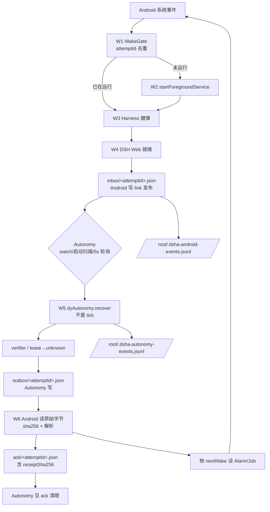

# ANDROID-REPORT-0004 · Android 平台负责人报告（平台能力契约 + 后台恢复设计 v4）

> 会话：Android 平台负责人（DSHA Android 平台专业智能体）
> 覆盖任务：`ANDROID-ARCH-AUDIT-01`、`ANDROID-BACKGROUND-RECOVERY-DESIGN-01/02/03`、v4 差异收口
> 迭代规则：本文件覆盖式更新、版本号递增（ANDROID-REPORT-0005…），不新增同类文件。
> 最近更新：2026-11-21 10:50 (Asia/Shanghai) · v4 与 Autonomy v3 收口（8 项差异）
> 性质：只读设计修订。未改 DSHA 源码/Manifest/服务/权限/profile/配置；未构建/安装 APK；未 kill/reboot；未启动 staging/scheduler/executor；未部署/重启；未改共享 HANDOFF/REPORT；未改 Autonomy 报告。

## 版本历史

| 版本 | 时间 | 变更摘要 |
|---|---|---|
| v1 (0001) | 11-21 02:45 | 首次建档：平台基线、19 项能力矩阵、权限矩阵、恢复设计初稿 |
| v2 (0002) | 11-21 09:55 | 12 项裁决：recover 入口、文件所有权、消费 8 问、回执/nextWake、四段状态机、日志拆分 |
| v3 (0003) | 11-21 10:05 | inbox/outbox/ack 队列化、ack 确认后清理、轮询「未收到≠失败」、nextWake 六字段、f2fs 持久性 |
| v4 (0004) | 11-21 10:50 | 与 Autonomy v3 收口 8 项：未 ack 永久保留、receiptSha256、`verifier_retry`、allowDefer 去软件下限、发布/半写统一协议、INBOX_FULL/BACKPRESSURE、ledger TTL 归属、merged/queued 语义 |

---

## 0. 阅读导航

**本轮结论：`PARTIAL`（Android 侧 7/8 完全对齐，E 项需 Autonomy v4 确认一处细化）**

- A/B/C/D/F/G/H 七项：**DESIGN ALIGNED**，Android v4 口径与 Autonomy v3 §8 一致
- E（发布/半写统一协议）：Android 按你要求增加「仍在发布中的文件 60s 内不得隔离」，Autonomy v3 §8.9 写的是「重试 3×50ms 后隔离」——**两者对"仍在写入"的等待窗口不一致**，需 Autonomy v4 确认按 60s（否则本项仍为 PARTIAL）
- 无 BLOCKED：所有运行期项目都是 NOT RUN（见 §8），不阻塞设计定稿

**八项差异一览**

| 项 | 主题 | v4 状态 |
|---|---|---|
| A | outbox 未 ack 回执 | 对齐（Android 不再有 7 天 TTL） |
| B | `receiptSha256` | 对齐（对 outbox 原始字节做 SHA-256） |
| C | `nextWake.reason=verifier_retry` | 对齐（纳入合法枚举 + 旧版兼容） |
| D | `allowDefer=false` | 对齐（删除 1min 软件下限） |
| E | 发布/半写/隔离 | **PARTIAL**（60s 窗口待对方确认） |
| F | `INBOX_FULL` / `BACKPRESSURE` | 对齐（不删未确认、退避、告警） |
| G | ledger TTL 归属 | 对齐（Android 不定义 TTL） |
| H | merged / queued | 对齐（默认排队，merged 独立回执） |

---

## 1. 基线（2026-11-21 10:42 重新核对）

| 对象 | 值 |
|---|---|
| `coordination/project-handoff` HEAD | `5e0159beff49e798101b11dc647030218f4fd4d6` |
| 本报告 v3 blob | `461a67d6e1fce877dbdeac2a3360830f66f6e594`（commit `a48fc33`） |
| Autonomy v3 | commit `de9b319ea1d747aa76e90d488ad315c1970c9e39` · blob `59b3b3b192c5e9f7be55b613a316372c22bcddff` |
| Memory 报告（只读，非本会话） | blob `5f96d640e99b9d2fc1eb4e22d8bb79051419a841` |
| `HANDOFF.md` / `REPORT.md` | `f8ffa40d…` / `e219f707…`（未改） |
| `DSH-APP/DSHA` main | `36d89b72294348d0482d509109cf8e76d51fc1cb` |
| 设备/运行时 | vivo V2154A · Android 14 · DSHA `0.2.1-rc.2-20261022.2100` · Ubuntu 24.04.3 · 伪 root uid 10328 · Node 24.19.0 |

---

## 2. 能力契约（保留 v3，未改）

### 2.1 四级：L1 端点存在 / L2 可调用 / L3 权限允许 / L4 效果已验证（禁止越级）

| # | 能力 | 入口 | 失败码 | 级别 |
|---|---|---|---|---|
| 1 | 读屏 | `/app/ui/dump` | `NO_PERMISSION` | L4 PASS |
| 2 | 截屏 | `/app/ui/screenshot` | `NO_PERMISSION` | L4 PASS（1080×2400） |
| 3 | 文字点按 | `/app/ui/tap?text=` | `NO_PERMISSION` | L2 / L4 NOT RUN |
| 4 | 输入 | `/app/ui/input` | `NO_PERMISSION` | L2 / L4 NOT RUN |
| 5 | 按键 | `/app/ui/key` | `NO_PERMISSION` | L2 / L4 NOT RUN |
| 6 | 手势 | `/app/ui/swipe`、`tap?gesture=` | `UNAUTHORIZED`/`UNKNOWN` | L1 / L4 NOT RUN |
| 7 | 应用启动 | `/app/launch` | `NO_CMD` | L2 / L4 NOT RUN |
| 8 | 通知 | `/app/notify` | `NO_PERMISSION` | L1 / L4 NOT RUN |
| 9 | 剪贴板读 | `/app/clip` | `NO_PERMISSION` | L4 PASS |
| 10 | 剪贴板写 | `/app/clip?text=` | `NO_PERMISSION` | L1 / L4 NOT RUN |
| 11 | 位置 | `/app/location` | `DISABLED` | L3 BLOCKED |
| 12 | 传感器 | `/app/sensors`、`/app/sensor` | `DISABLED` | L4 PASS |
| 13 | 手电 | `/app/torch` | `NO_PERMISSION` | L1 / L4 NOT RUN |
| 14 | 虚拟屏 | `/app/vscreen/*` | `VSCREEN_NOT_RUNNING` | L2 / L4 NOT RUN |
| 15 | 应用清单 | `/app/apps` | `NO_CMD` | L4 PASS |
| 16 | 插件状态 | `/app/plugins` | `NO_CMD` | L4 PASS |
| 17 | 设备文件读 | `/app/readfile` | `FORBIDDEN` | L2 FAIL |
| 18 | 交互类 | `ask/toast/vibrate/share/open/export` | `NO_CMD` | L1 / L4 NOT RUN |
| 19 | 设备 shell | `adb-shell` | `POLICY_BLOCKED`(126) | L4 PASS（只读） |

### 2.2 失败码（冻结）：`UNAUTHORIZED`｜`NO_CMD`｜`POLICY_BLOCKED`｜`DISABLED`｜`NO_PERMISSION`｜`VSCREEN_NOT_RUNNING`｜`FORBIDDEN`；附加 `EXECUTION_UNKNOWN`（可能已执行，不重放）。

### 2.3 权限/风险：已授 20 项；未授 `MANAGE_EXTERNAL_STORAGE`/`SYSTEM_ALERT_WINDOW`/`REQUEST_INSTALL_PACKAGES`；未声明 SMS/通讯录/相机；R1–R10 不变。

---

## 3. v4 差异收口（A–H）

### A. outbox 未 ack 回执

| 维度 | Android v3 原口径 | Autonomy v3 原口径 | **v4 统一口径** | Android 实现责任 | NOT RUN 验收 |
|---|---|---|---|---|---|
| 未 ack 回执 | 最长 7 天 TTL 后清理 | **未 ack 不自动删除**；如运维必须清理，须先复制进 ledger 并记 `OUTBOX_TTL_PURGED` | **未 ack 一律不自动清理**；Android 不再持有任何 outbox TTL | Android 只读，不删；读到后**先写 ack** 再认为已读 | 造 10 条未 ack 回执，运行 30 天模拟（时钟注入）后仍在 |
| 读 → ack 顺序 | 读后写 ack（未强调顺序） | 以 ack 判定已读 | **先完整解析 → 落盘 ack（含 sha256）→ 才标记本地已读**；ack 失败则下次唤醒补读补写 | `ack/<id>.json` 写失败记 `ACK_WRITE_FAILED` 并重试 | 断电容错：ack 写一半崩溃后重启补写 |
| outbox 满 | 未定义 | `rejected/BACKPRESSURE`，不丢旧回执 | 同 Autonomy；Android **不删任何回执**，只降低新请求频率 | 收到 BACKPRESSURE → 6h 内不发非紧急请求 | 模拟 500 条满载，验证不丢旧回执 |
| 500 满载告警/恢复 | 未定义 | 80% 记 `INBOX_HIGH` | 80%（400）记 `OUTBOX_HIGH` 并**每天最多一次**用户可见提示；满载时只保留预留槽位写拒绝回执；恢复由负责人/DSH 处理队列，**不得删除未确认回执** | Android 发 `/app/notify` 低频告警；事件写 `QUEUE_BLOCKED` | 构造满载 + 预留槽位，验证仍有拒绝回执 |

### B. `receiptSha256`

| 维度 | Android v3 | Autonomy v3 | **v4** | 责任 | NOT RUN |
|---|---|---|---|---|---|
| 计算对象 | 仅字段名出现 | 必须是 outbox 文件**原始字节** | **对 `outbox/<id>.json` 原始字节做 SHA-256**（读取时一次读入字节，先算 hash 再解析；解析与 hash 用同一份字节） | Android 实现「读字节 → sha256 → 解析 → 校验 attemptId」 | 用已知向量验证 hash 与 Autonomy 计算一致 |
| ack 字段 | schema/attemptId/readAt/result/receiptSha256 | 同 | 同 v3 + `schema=1`；`result` 取自回执；`readAt` 为 Android 时钟 | — | ack 被 Autonomy 校验通过率 100% |
| 一致性判定 | 未定义 | sha256 不一致视为未 ack、保留回执 | 同；Android 若发现 `attemptId` 与文件名不符 → `RECEIPT_INVALID`，不写 ack | 不一致时不 ack、下次重读 | 篡改回执 1 字节 → 不 ack |

### C. `nextWake.reason = verifier_retry`

| 维度 | Android v3 | Autonomy v3 | **v4** | 责任 | NOT RUN |
|---|---|---|---|---|---|
| 枚举 | `backoff/lease/budget/none` | 新增 `verifier_retry` | **接受 `verifier_retry`**，写进合法枚举 | 解析层白名单 | — |
| 语义 | — | verifier 触发的重验请求 | **不得降级为 budget**：Android 原样保留 reason 字符串，不得改写 | 事件里记原始 reason | — |
| 调度 | — | 按 `allowDefer` 分流 | 调度只由 `allowDefer/mode/notBefore/latest` 决定；`verifier_retry` 本身不额外加延迟，也不特殊提速 | `floor` 仅由 allowDefer 决定 | 断言 notBefore 不被改写 |
| 旧版兼容 | — | 若 Android 拒绝则退回 `lease`+confidence | Android v4 起认识；**万一遇到未知 reason**：原样保留、按 `lease` 同等紧急度调度、记 `UNKNOWN_REASON_FALLBACK:<raw>`，绝不重写文件 | 兼容分支 | 注入未知 reason 断言不丢字段 |
| 其他字段 | — | 不变 | `mode/allowDefer/confidence` 语义不变 | — | — |

### D. `allowDefer=false`

| 维度 | Android v3 | Autonomy v3 | **v4** | 责任 | NOT RUN |
|---|---|---|---|---|---|
| 下限 | 1min 软件 floor | 不得被普通 10min 下限无理由推迟 | **删除 1min 软件 floor**；`effective = max(notBefore, now)`，再受 `latest` 与 24h 兜底约束 | 计算层 | 断言不再出现 +60s |
| 到时行为 | 未明确 | 按 notBefore 请求系统调度 | `notBefore` 已过 → **立即请求系统调度**（app 在前台可直接 startForegroundService；后台走 alarm/FGS，被拒记 `WAKE_START_DENIED`） | 调度层 | 前台/后台两路径各一例 |
| 系统延迟 | 未区分 | 记 `DEFERRED_BY_SYSTEM` + actualAt | 同；另记可观测原因（Doze/AppStandby/FGS 限制/OEM），**不得写成 Autonomy 主动 defer** | 事件层 | 注入 Doze 模拟，断言错误分类 |
| 10min 下限 | 全局 | 只约束 allowDefer=true | 只对 `allowDefer=true`（budget/none）生效 | — | — |

### E. 发布与半写（PARTIAL：60s 窗口待确认）

| 维度 | Android v3 | Autonomy v3 | **v4** | 责任 | NOT RUN |
|---|---|---|---|---|---|
| 发布方式 | link 优先，降级 O_EXCL+写+fsync | 请求用 link（不可覆盖）；回执/ack 用 rename；不支持 link 时降级 | 统一：请求=link（目标存在则换 seq，绝不覆盖）；回执/ack=rename（本模块独占文件名）；降级=O_EXCL create → write → fsync | Android 只对 inbox 用 link/降级；outbox/ack 不写 | fallback 路径实测（hardlink 支持性 NOT RUN） |
| 识别「正在发布」 | 未定义 | 读者 3×50ms 重试后隔离 | **`.tmp-*` 一律不解析**；final 解析失败时：①重试 3×50ms；②若文件 mtime 年龄 <60s → 视为**可能仍在写入**，本轮不隔离、下轮再试；③年龄 ≥60s 仍无效 → 才移入 `.corrupt-<ts>` | 读方（Android 只读 outbox，隔离仅限自己读到的坏回执需谨慎：**outbox 属 Autonomy，Android 不移动其文件**，只记 `RECEIPT_INVALID` 并等其重写） | 半写注入：写 1KB 后暂停，验证 60s 内不隔离 |
| 崩溃恢复 | 清理 >1h tmp | 同 | 启动清理 >1h `.tmp-*`；Android 对**自己**的 inbox 半写文件：同 attemptId 重写（幂等，记 `REPAIR_OWN_PARTIAL`）；不触碰他人文件 | Android | 断电模拟后重启，验证可自愈 |
| 不覆盖 attemptId | 已写 | 已写 | 同：link 失败或已存在 → 换 seq；降级路径先 `exists()` 再 rename，单写者假设 + 事后校验 attemptId，冲突记 `ATTEMPT_ID_COLLISION` | Android | 并发两次同 id，验证只一份有效 |
| **差异点** | — | 3×50ms 后即隔离 | Android 要求 60s 观察窗（你的裁决） | — | **需 Autonomy v4 确认** |

> 说明：`/root` 为 f2fs（`df -T` 实测），同目录 rename/link 原子；跨目录不原子；PRoot 下 `link` 可用性未实测 → NOT RUN，降级路径必须实现。

### F. `INBOX_FULL` / `BACKPRESSURE`

| 维度 | Android v3 | Autonomy v3 | **v4** | 责任 | NOT RUN |
|---|---|---|---|---|---|
| 80% 预警 | 写 `INBOX_HIGH` | 同 | 400 条记 `INBOX_HIGH`，每天最多一次用户可见提示（`/app/notify`） | Android | 造假 400 条验证只提示一次 |
| 满载 500 | 拒绝并记 `INBOX_FULL` | 不删未 ack | 同；**不覆盖、不删除任何未确认请求** | Android | 500 条时确认零删除 |
| 写失败退避 | 退避 | — | 30min → 60min → 2h（上限 2h），只重试**同一 attemptId**（不新建） | Android | 断言 attemptId 不变 |
| BACKPRESSURE 后 | 未定义 | 回执 `rejected/BACKPRESSURE` | 收到后 6h 内只发 `allowDefer=false` 的紧急请求；其余挂起；1 次用户提示 + `QUEUE_BLOCKED` 事件 | Android | 模拟 BACKPRESSURE，验证 6h 内只发紧急 |
| 负责人介入 | 未定义 | — | 连续 3 次 `INBOX_FULL`/`BACKPRESSURE` → 提示「队列堵塞，请 DSH 处理」，**不自动清理** | Android | 提示只发一次/天 |
| 超时重做 | 未定义 | — | **禁止**因请求超时自动新建 attemptId 重做；重试一律同 id，重做必须新 id + `RETRY_OF` | Android | 断言事件里无隐式新 id |

### G. ledger TTL 归属

| 维度 | Android v3 | Autonomy v3 | **v4** | 责任 | NOT RUN |
|---|---|---|---|---|---|
| TTL 表述 | 写「幂等表 TTL 1h」 | `recovery_requests` 保留 **30 天**，未决/未 ack 永久 | **Android 不再定义任何 ledger TTL**；只写「保留时间由 Autonomy 契约决定」 | 文档层 | — |
| 幂等依赖 | attemptId | 同 | Android 只依赖「同一 attemptId 不重复执行」契约 | — | — |
| 重试 | 新 attemptId + `RETRY_OF` | 同 | 同 v3；补「必须先收到旧 id 的终态回执或确认 `latest` 已过才重试」 | Android | 断言不提前重试 |

### H. `merged` / `queued`

| 维度 | Android v3 | Autonomy v3 | **v4** | 责任 | NOT RUN |
|---|---|---|---|---|---|
| 新请求默认 | 可被合并 | **默认 `queued`**，不合并执行 | **默认排队**；Android 不得假设「恢复中 = 会被合并」 | Android | — |
| 静默合并/丢弃 | 允许合并 | 禁止静默 | 禁止；只有 Autonomy 明确返回 `merged` 才按 merged 处理 | Android | 注入并发请求，验证两条都有回执 |
| merged 语义 | 可终态 | `merged + mergedInto`，leader `done + mergedFrom[]` | 同；**merged ≠ 未被处理**，Android 不得重发该 id | Android | 验证 merged 不回重试 |
| 独立回执 | 未明确 | 每个 id 独立回执 | 同 | — | 计数校验：请求数 = 回执数 |

---

## 4. 保留设计（受 A–H 影响处已更新）

### 4.1 架构图

### 4.2 状态机（W1–W6）

`REQUESTED → INBOXED → W2/W3(ANDROID_UP/HARNESS_UP) → W4 WEB_UP → REQUEST_PUBLISHED → W6 POLLING → CONFIRMED → ACKED → CLEANED`；
`POLLING --latest 过--> UNCONFIRMED`（非终态，下次唤醒补读）；`SUPPRESSED_*` / `WAKE_START_DENIED` 为终态或需退避。
**W6 未收到回执 ≠ W5 执行失败**；`merged` 是该 id 的独立终态。

### 4.3 参数（更新）

| 项 | 值 |
|---|---|
| 心跳 / 重启冷却 / 失败阈值 | 15s / 120s / 3 |
| Alarm | 30min 正常 · 15min 紧急 · 60min 空闲 |
| 下限 | `allowDefer=true` 10min；`allowDefer=false` **无软件下限** |
| 失败退避 | 1/2/4/8/16/32/60min，日封顶 48 |
| 请求 TTL | 10min 过期；`latest` 为执行窗上界 |
| 回执轮询 | 1s→30s，到 latest 停 |
| 队列 | inbox/outbox 各 500；ack 24h；**未 ack 永久**；corrupt 30d |
| 事件日志 | 2MB×2 |
| 并发 | ≤2 subagent + ≤1 Chromium |

### 4.4 失败场景（增补至 27 条）

原 24 条保留；新增：25 `OUTBOX_HIGH/QUEUE_BLOCKED`（80%/满载告警）；26 `UNKNOWN_REASON_FALLBACK`（未知 reason 按 lease 处理并保留原串）；27 `REPAIR_OWN_PARTIAL`（Android 修复自己半写的 inbox，同 id 幂等）。

### 4.5 队列与消费规范（v3 保留，v4 仅改 TTL/隔离/告警）

- `attemptId = "w-" + bootId8 + "-" + reason + "-" + windowStartMin + "-" + seq`，字符集 `[a-z0-9-]`，≤96 字符
- 顺序：Autonomy 按 `requestedAt` 升序（同值按文件名），一次一个 inflight
- 消费通道：Host 内部调用（boot/启动）→ 目录 `fs.watch('/root/.dsha-wake/inbox')` 去抖 300ms → 5s 目录轮询 → 60s 维护扫描
- 半写：读者只解析 final 文件；`.tmp-*` 忽略；解析失败 3×50ms 重试 → 60s 观察窗（见 E）→ 隔离
- 重启：Android 扫 outbox 补读补 ack、扫 inbox 未 ack 的保留；Autonomy 扫 inbox 未 ingest、scan ledger 未完成、重写丢失回执
- 幂等：同一 attemptId 永不重复执行；重试必须新 id + `RETRY_OF:<旧 id>`

### 4.6 回执字段与 nextWake（v4）

回执（Autonomy 写）：`schema, attemptId, requestId, result(accepted|rejected|deferred|done|expired|failed|merged), errorCode, runtimeId, bootId, startedAt, finishedAt, pendingTasks{5 类}, recovery{scanned,claimed,counts,results,errors}, nextWake, mergedFrom[] | mergedInto, duplicate`
ack（Android 写）：`schema, attemptId, readAt, result, receiptSha256`
nextWake：`{schema, notBefore, latest, reason(lease|backoff|verifier_retry|budget|none), mode(check|recover), allowDefer, confidence, at(=notBefore 别名)}`
- Android 计算：`effective = min(max(notBefore, now), latest, now+24h)`；`allowDefer=true` 才加 10min 下限
- 缺失 nextWake → 默认 check/30min；最终值与理由记 `NEXT_WAKE_SET`

### 4.7 失败场景（27 条）

| # | 段 | 场景 | 处理 | 码 |
|---|---|---|---|---|
| 1 | W1 | 同窗口重复 | 丢弃 | `DEDUPED` |
| 2 | W1 | 频率过高 | 丢弃 | `THROTTLED` |
| 3 | W1 | 低内存 | 只检查 | `DEFERRED_LOW_MEMORY` |
| 4 | W2 | 后台 FGS 被拒 | 退避，不换通道 | `WAKE_START_DENIED` |
| 5 | W2 | force-stop | 等用户打开 | `IRRECOVERABLE_USER_FORCE_STOP` |
| 6 | W3 | stop sentinel | 不启动 | `SUPPRESSED_USER_STOPPED` |
| 7 | W3 | 连续失败阻塞 | 提示恢复页 | `SUPPRESSED_RESTART_BLOCKED` |
| 8 | W3 | 会话状态未知 | 不自动启动 | `SUPPRESSED_RESTORE_UNKNOWN` |
| 9 | W4 | web 起不来 | 现有 3 次+120s | `RESTORE_FAILED` |
| 10 | W2/W4 | 进程与 node 不同步 | 分别探测 | `STAGE_MISMATCH` |
| 11 | 队列 | attemptId 冲突 5 次 | 放弃本轮 | `ATTEMPT_ID_COLLISION` |
| 12 | 队列 | inbox 满 | 拒绝新请求 | `INBOX_FULL` |
| 13 | 队列 | outbox 满 | 拒绝新恢复，保留旧回执 | `BACKPRESSURE` |
| 14 | 队列 | 半写入/损坏 | 观察窗后隔离 | `WAKE_FILE_INVALID` |
| 15 | 队列 | 磁盘满 | 保留旧文件+退避 | `STORAGE_LOW` |
| 16 | 队列 | tmp 残留 | 启动清理 >1h | `TMP_CLEANED` |
| 17 | 队列 | 目录 fsync 失败 | 记事件继续 | `DIRSYNC_FAILED` |
| 18 | W6 | 到 latest 未收到 | 标 UNCONFIRMED | `RECEIPT_TIMEOUT` |
| 19 | W6 | 回执损坏 | 不 ack、等重写 | `RECEIPT_INVALID` |
| 20 | W6 | ack 写失败 | 下次补写 | `ACK_WRITE_FAILED` |
| 21 | W5 | 请求过期 | 回执 expired | `REQUEST_EXPIRED` |
| 22 | W5 | 恢复中又到请求 | 排队（或对方明确 merged） | `QUEUED`/`MERGED` |
| 23 | 任意 | 时间跳变 | 只影响窗口 | `CLOCK_JUMP` |
| 24 | 任意 | 事件日志写失败 | 降级 DiagnosticLog | `EVENTLOG_FALLBACK` |
| 25 | 队列 | 80%/满载告警 | 每天一次提示 | `OUTBOX_HIGH`/`QUEUE_BLOCKED` |
| 26 | nextWake | 未知 reason | 按 lease 处理、保留原串 | `UNKNOWN_REASON_FALLBACK` |
| 27 | 队列 | 自己半写的 inbox | 同 id 重写（幂等） | `REPAIR_OWN_PARTIAL` |

---

## 5. 证据索引

- 源码：`DSH-APP/DSHA` @ `36d89b7`（BootReceiver 51-88；HarnessService 47-49/199-270/484-577；AdbKeepAliveReceiver 22-33；AutomaticBackups 49-69；WebLifecycleController 878-895/1917-1922/1936-1948；WebLifecycle 53-55；DiagnosticLog 14-36；app-integration/index.js 16-50）
- 平台：`df -T /root` = f2fs；`/proc/sys/kernel/random/boot_id` 可读；`fs.watch('/root')` 可注册（本轮只读复核，10:44）
- 跨报告：Autonomy v3（`de9b319`，blob `59b3b3b1…`）§8.1–8.11
- 设备：pid 22300、FGS、Doze 白名单含 10328、`MemAvailable 2.41GB`（09:44）

---

## 6. 决策 / 授权 / 一致性

### 6.1 仍需 GPT 裁决
1. **E 项 60s 观察窗**：是否要求 Autonomy v4 把「3×50ms 后隔离」改成「60s 观察窗」（本报告按你的要求已改为 60s）。
2. 80% 告警的频率上限（本报告取「每天一次」）。
3. `BACKPRESSURE` 后 6h 冷却是否接受。

### 6.2 需负责人授权
test APK｜kill/reboot 实验｜staging｜生产灰度与开关｜电池优化白名单长期依赖。

### 6.3 一致性状态
A/B/C/D/F/G/H：**DESIGN ALIGNED**（与 Autonomy v3 §8 逐项一致）。
E：**PARTIAL**（Android 增加 60s 观察窗，Autonomy v3 为 3×50ms 后隔离；需其 v4 确认或由你裁定）。
无 BLOCKED。

---

## 7. 变更摘要

**修正**：outbox 7 天 TTL → 未 ack 永久；1min 软件 floor → 无下限；ledger TTL 1h → 不定义；隔离策略 → 60s 观察窗；新增 `verifier_retry`、`receiptSha256` 原始字节口径、`BACKPRESSURE`/`INBOX_FULL` 退避与告警、`merged≠未处理`。
**保留**：四段状态机、inbox/outbox/ack 目录、consume 机制、W6≠W5、19 项能力契约与失败码。
**未解决**：E 的 60s 窗口（待对方确认）；hardlink 在 f2fs/PRoot 的可用性（NOT RUN）；全部真机项（§8）。

---

## 8. NOT RUN（不得写成真机通过）

目录级 `fs.watch` 稳定性｜f2fs fsync 延迟｜ENOSPC｜hardlink 不可用降级实测｜kill/reboot｜Android 写 inbox/读 outbox/写 ack 全链路｜双 worker 并发｜test APK｜staging｜FGS 后台启动被拒｜OEM 拦截｜force-stop 真实表现｜`appops` 级证据。

---

## 9. 边界声明

本轮只读设计修订：未改 DSHA 源码/Manifest/服务/权限/profile/配置；未构建/安装 APK；未 kill/reboot；未启动 staging/scheduler/executor；未部署/重启；未改生产 DB；未改 `HANDOFF.md`/`REPORT.md`/`PROJECT.md`；未修改 Autonomy/Memory/Persona 报告。
