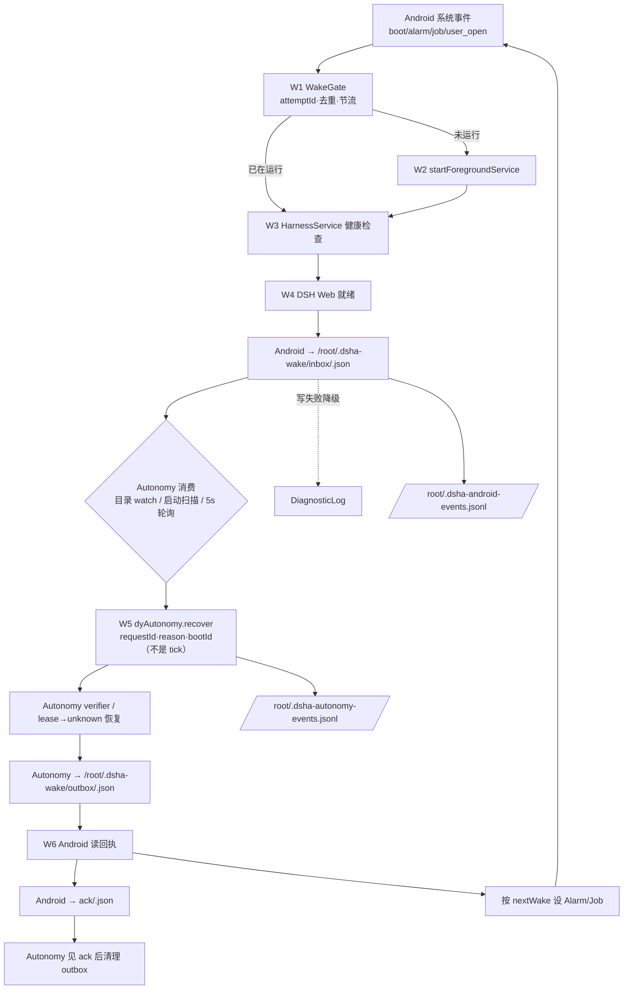

# ANDROID-REPORT-0003 · Android 平台负责人报告（平台能力契约 + 后台恢复设计 v3）

> 会话：Android 平台负责人（DSHA Android 平台专业智能体）
> 覆盖任务：`ANDROID-ARCH-AUDIT-01`、`ANDROID-BACKGROUND-RECOVERY-DESIGN-01/02/03`
> 迭代规则：本文件覆盖式更新、版本号递增（ANDROID-REPORT-0004…），不新增同类文件；与 `coordination/HANDOFF.md`、`coordination/REPORT.md` 同目录。
> 最近更新：2026-11-21 10:05 (Asia/Shanghai) · v3 按 GPT 联合接口裁决修订（请求队列、回执持久化、nextWake、f2fs 持久性）
> 性质：只读设计修订。未改 DSHA 源码/Manifest/服务/配置/权限；未装包、未部署、未重启、未 kill/reboot、未启动 staging/调度；未碰生产库；未改共享 HANDOFF/REPORT/PROJECT；未改 Autonomy 接口或其报告。

## 版本历史

| 版本 | 时间 | 覆盖任务 | 变更摘要 |
|---|---|---|---|
| v1 (ANDROID-REPORT-0001) | 2026-11-21 02:45 | ARCH-AUDIT-01 + DESIGN-01 | 首次建档：平台基线、19 项能力矩阵、权限矩阵、后台可靠性、恢复设计初稿 |
| v2 (ANDROID-REPORT-0002) | 2026-11-21 09:55 | + DESIGN-02 | 按 12 项裁决修订：recover 入口、文件所有权、消费 8 问、回执与 nextWake、四段状态机、事件日志拆分、能力契约与失败码 |
| v3 (ANDROID-REPORT-0003) | 2026-11-21 10:05 | + DESIGN-03 | 请求/回执改为 inbox/outbox **一请求一文件**队列；ack 语义与保留策略；回执轮询「未收到≠失败」；nextWake 六字段与 allowDefer；f2fs 原子写/fsync/损坏/配额规则；§5.3 三项标记已对齐 |

---

## 0. 给 GPT 的阅读导航（先看这一节）

**本轮 6 项修订**
1. **单文件 → 队列**：`wake.json` / `wake-result.json` 改为 `/root/.dsha-wake/{inbox,outbox,ack}/<attemptId>.json`，一请求一文件，不同 attemptId 不再互相覆盖（§3.3–3.5）。
2. **确认后才清理**：Android 写 `ack/<attemptId>.json` 后，Autonomy 才可删除 outbox 条目；未 ack 的回执最长保留到 7 天/TTL，**不得静默丢**（§3.5）。
3. **回执轮询语义**：停止轮询 ≠ 丢弃请求；`RECEIPT_TIMEOUT` 只是 W6 传输观测，**不能推导 W5 失败**；下次唤醒先补读未确认回执，同一 attemptId 绝不重复执行（§3.8）。
4. **nextWake 六字段**：`notBefore/latest/reason/mode/allowDefer/confidence`；普通周期 10min 下限，`allowDefer=false` 的紧急核实不被普通下限主动延后（仍受系统限制），24h 封顶（§3.9）。
5. **f2fs 持久性**：同目录 tmp + fsync(file) + 发布（hardlink 或 rename）+ fsync(dir)、0600、损坏隔离、磁盘满、轮转与清理、崩溃恢复（§3.6）。
6. **§5.3 三项已对齐**：引用 Autonomy v2（commit `01afc56`，blob `899528d7…`），不再列为待修复（§5.3）。

**仍需 GPT 裁决（§5.1）**
1. 目录化契约（inbox/outbox/ack）需 **Autonomy v3** 确认（其 v2 §8.1–8.8 仍写单文件）。
2. 队列上限与保留：inbox/outbox 各 500 条、ack 24h、回执未 ack 最长 7 天，是否接受。
3. `allowDefer=false` 的紧急下限：Android 侧取 1min（其余交给系统调度），是否接受。
4. hardlink 发布不可用时的降级顺序（O_EXCL+写+fsync）是否接受。

**需负责人授权（§5.2）**：test APK、kill/reboot 实验、staging、生产灰度与开关、电池优化白名单长期依赖。

---

## 1. 基线（2026-11-21 09:43–10:00 重新核对）

| 对象 | 值 | 核对方式 |
|---|---|---|
| `coordination/project-handoff` HEAD | `01afc56cd8067a089e26525cba276a5ed2abf262` | `git fetch` + `ls-remote` 一致 |
| `coordination/Android 平台负责人报告.md`（v2） | blob `1a3de74f203df871da6ef142d3e71fe8f0ff8fbf` | `git ls-tree` |
| `coordination/Autonomy 自主系统负责人报告.md`（v2） | blob `899528d74538d6033bc4128a906cfe486d7b7880` | 同上 |
| `coordination/HANDOFF.md` | `f8ffa40d4c27c04d23ff74b123bf2b7044821976` | 本轮未改 |
| `coordination/REPORT.md` | `e219f707cc4363c53704fbe389f786148142326e` | 本轮未改 |
| `DSH-APP/DSHA` main | `36d89b72294348d0482d509109cf8e76d51fc1cb` | `ls-remote` |
| `ba-song/dsh-autonomy` main | `6c4a4753b4737060211955b1f022cab2f1d39521` | `ls-remote` |
| `ba-song/dsh-memory-core` main | `7548e49ed0b8d8673818464325d8e72ec7704b27` | `ls-remote` |
| 设备 | vivo V2154A · Android 14 (SDK 34) · 存储 105.57GB 可用 · `MemAvailable 2.41GB` | `/app/device` 09:44 |
| DSHA 进程 | pid 22300 · 连续 1d22h12m · FGS 在跑 | `dumpsys activity processes` 09:45 |
| 运行时 | Ubuntu 24.04.3 · PRoot `-0` · 伪 root uid 10328 · Node 24.19.0 | `ps`/`/proc/self/status` |

---

## 2. 能力契约与失败码（保留 v2，未改）

### 2.1 四级判定

`L1 端点存在 → L2 可调用 → L3 权限允许 → L4 效果已验证`；结论必须写成「L1 PASS / L2 PASS / L3 DISABLED / L4 NOT RUN」，禁止越级。

### 2.2 契约表（19 项）

| # | 能力 | 入口 | 关键权限 | 失败码 | 级别 |
|---|---|---|---|---|---|
| 1 | 读屏语义树 | `/app/ui/dump` | 无障碍 | `NO_PERMISSION` | L4 PASS |
| 2 | 截屏 | `/app/ui/screenshot` | 无障碍+截图 | `NO_PERMISSION`/`UNKNOWN` | L4 PASS（1080×2400） |
| 3 | 文字点按 | `/app/ui/tap?text=` | 无障碍 | `NO_PERMISSION` | L2 PASS / L4 NOT RUN |
| 4 | 输入 | `/app/ui/input` | 无障碍+焦点 | `NO_PERMISSION` | L2 PASS / L4 NOT RUN |
| 5 | 按键 | `/app/ui/key` | 无障碍 | `NO_PERMISSION` | L2 PASS / L4 NOT RUN |
| 6 | 手势 | `/app/ui/swipe`、`tap?gesture=` | 无障碍+最新截图凭据 | `UNAUTHORIZED`/`UNKNOWN` | L1 PASS / L4 NOT RUN |
| 7 | 应用启动 | `/app/launch` | `QUERY_ALL_PACKAGES` | `NO_CMD`/`UNKNOWN` | L2 PASS / L4 NOT RUN |
| 8 | 通知 | `/app/notify` | `POST_NOTIFICATIONS` | `NO_PERMISSION` | L1 PASS / L4 NOT RUN |
| 9 | 剪贴板读 | `/app/clip` | 前台 | `NO_PERMISSION` | L4 PASS |
| 10 | 剪贴板写 | `/app/clip?text=` | 前台 | `NO_PERMISSION` | L1 PASS / L4 NOT RUN |
| 11 | 位置 | `/app/location` | 定位已授+DSHA 开关 | `DISABLED` | L3 BLOCKED |
| 12 | 传感器 | `/app/sensors`、`/app/sensor` | 无 | `DISABLED` | L4 PASS（light=31.79 lux） |
| 13 | 手电 | `/app/torch` | 闪光灯 | `NO_PERMISSION`/`UNKNOWN` | L1 PASS / L4 NOT RUN |
| 14 | 虚拟屏 | `/app/vscreen/*` | Android 11+ | `VSCREEN_NOT_RUNNING` | L2 PASS / L4 NOT RUN |
| 15 | 应用清单 | `/app/apps` | `QUERY_ALL_PACKAGES` | `NO_CMD` | L4 PASS（45 用户/424 可见） |
| 16 | 插件状态 | `/app/plugins` | 无 | `NO_CMD` | L4 PASS |
| 17 | 设备文件读 | `/app/readfile` | Android 权限+白名单 | `FORBIDDEN` | L2 FAIL（`/sdcard/*` 全拒） |
| 18 | 交互类 | `/app/ask|toast|vibrate|share|open|export` | 各自 | `NO_CMD`/`UNKNOWN` | L1 PASS / L4 NOT RUN |
| 19 | 设备 shell | `adb-shell` | uid2000 通道+设备策略 | `POLICY_BLOCKED`(126)/`UNAUTHORIZED` | L4 PASS（只读） |

### 2.3 失败码（冻结，未改）

`UNAUTHORIZED`（重新取凭据，不重放）｜`NO_CMD`（能力不存在）｜`POLICY_BLOCKED`（126，停止，不绕道）｜`DISABLED`（产品开关，提示去设置）｜`NO_PERMISSION`（系统权限，提示设置）｜`VSCREEN_NOT_RUNNING`（需显式 create）｜`FORBIDDEN`（路径策略，换合法路径）。附加 `EXECUTION_UNKNOWN`：可能已执行，先核对，不自动重放。

### 2.4 权限与风险（保留 v2）：已授 20 项；未授 `MANAGE_EXTERNAL_STORAGE`/`SYSTEM_ALERT_WINDOW`/`REQUEST_INSTALL_PACKAGES`；未声明 SMS/通讯录/相机；R1–R10 不变（内存、进程内定时、短信、录音、位置、readfile、appops、自启/被杀、LAN token、生产镜像缺 exporter/P4）。

---

## 3. 后台恢复设计 v3

### 3.1 12 项裁决 → 设计映射（同 v2）

FGS+心跳保留 · Alarm 检查兜底 · JobScheduler 跨重启 · Boot 受 sentinel 门控 · 不新增精确闹钟权限 · 15–30min 初期目标 · Alarm→Boot→灰度 · force-stop 不恢复 · 事件日志分离 · Autonomy 唯一裁决 · 回执由 Autonomy 写 · Android 不解释任务语义。

### 3.2 统一架构图（v3：队列化）



**强调**：`W5` 是独立 recovery 入口，不是 `tick({trigger:'resume'})`；`W6` 未收到回执**不能**推导 W5 失败。

### 3.3 目录与所有权（v3 变更）

```
/root/.dsha-wake/
  inbox/    <attemptId>.json   # Android 写 / Autonomy 读
  outbox/   <attemptId>.json   # Autonomy 写 / Android 只读
  ack/      <attemptId>.json   # Android 写 / Autonomy 读
  legacy/   wake.json, wake-result.json   # v2 单文件迁移备份（只读，1 个版本后删）
```

| 目录/文件 | 写入方 | 读取方 | 清理方 | 清理条件 |
|---|---|---|---|---|
| `inbox/<attemptId>.json` | Android | Autonomy | Android | 收到 ack 后 24h，或请求过期 7 天（需记事件） |
| `outbox/<attemptId>.json` | Autonomy | Android | Autonomy | 见到 ack 后 10min，或 7 天 TTL（需记事件） |
| `ack/<attemptId>.json` | Android | Autonomy | Android | 写入后 24h |
| `/root/.dsha-web-activity.json` | DSH Host | Android | DSH Host | 既有策略 |
| `/root/.dsha-android-events.jsonl` | Android | 诊断 | Android | 2MB×2 轮转 |
| `/root/.dsha-autonomy-events.jsonl` | Autonomy | 诊断 | Autonomy | 2MB×2 轮转 |

**禁止**：两模块共写同一文件；Android 读写 `autonomy.db`；Autonomy 写 inbox/ack。

### 3.4 请求队列（inbox）规范

- 文件名 = `attemptId`，字符集 `[a-z0-9-]`，长度 ≤96；`attemptId = "w-" + bootId8 + "-" + reason + "-" + windowStartMin + "-" + seq`
- **唯一性**：`attemptId` 由 Android 生成；冲突（同窗口同 seq）→ seq+1 重试，最多 5 次；仍冲突记 `ATTEMPT_ID_COLLISION`
- **不覆盖**：发布前若目标已存在 → 不写、seq+1；**绝不 rename 覆盖已有 attempt**
- **顺序**：Autonomy 按 `requestedAt` 升序（同值按文件名）消费，一次一个 inflight
- **上限**：500 条；80% 记 `INBOX_HIGH`；满则拒绝新请求（`INBOX_FULL`），**不删除未 ack 条目**
- **字段**：`schema, attemptId, bootId, reason, requestedAt, notBefore, latest, deadline, generation, mode, allowDefer`

### 3.5 回执队列（outbox）与 ack

- Autonomy 每个 attemptId 写**恰好一个**回执（含 merged 的每个 attemptId 都有）
- `result` 取值：`accepted | rejected | deferred | done | expired | failed | merged`
- `merged` 必须带 `mergedInto=<主 attemptId>`；主回执带 `mergedFrom[]`（≤5），两边都可终态
- **保留**：未 ack 的回执不得删除；上限 500；满则 Autonomy 拒绝新的恢复（回执 `rejected/BACKPRESSURE`），不丢旧回执
- **ack**：Android 成功解析并落盘判定后写 `ack/<attemptId>.json`：`{schema, attemptId, readAt, result, receiptSha256}`；写失败则下次唤醒重试（`ACK_WRITE_FAILED`）
- Autonomy 见到 ack（或 7 天 TTL）才清理 outbox；Android 见到自己的 ack 才清理 inbox

### 3.6 原子写与持久性（f2fs 规则）

| 步骤 | 规则 |
|---|---|
| 1 写临时 | 目标同目录创建 `.tmp-<attemptId>-<pid>-<rand>`，`O_CREAT|O_EXCL`，`0600` |
| 2 落盘 | `write` → `fsync(fd)` → `close` |
| 3 发布 | 首选 `link(tmp, final)`（目标已存在则失败，**天然不覆盖**）；不可用时退化为 `O_EXCL create final → write → fsync`（内容可能半写，由读取方校验丢弃） |
| 4 目录持久 | `fsync(dirfd)`（rename/link 的元数据落盘） |
| 5 清理 tmp | 发布后 unlink tmp；启动时清理 >1h 的 `.tmp-*` |
| 读取 | 校验大小 ≤64KB、JSON 完整、`schema=1`、`attemptId === 文件名`；失败 → 移入 `<name>.corrupt-<ts>` + 事件，**不静默删** |
| 磁盘不足 | 写入失败保留旧文件；记 `STORAGE_LOW`，退避；不降级到 `/sdcard` |
| f2fs 注意 | 同目录 rename/link 原子；跨目录不原子；不依赖 mtime 精度（用内容 hash 判定变化）；`inline_dentry` 不影响 rename 语义 |

### 3.7 消费机制（9 问，含 v3 队列）

| 问题 | 机制 |
|---|---|
| 1. 已运行时如何收到 | Autonomy 在 `apply()` 注册 `fs.watch('/root/.dsha-wake/inbox', {persistent:false})`（目录级），300ms 去抖；只处理新增/变更文件 |
| 2. 触发通道分工 | Host 内部调用（boot/启动）→ 目录 watch（运行时）→ 5s 目录轮询（兜底）→ 60s 维护扫描（最后兜底） |
| 3. 启动与运行时统一 | 同一 `consumeInbox(reason)`：扫描未处理文件、按 `requestedAt` 排序、逐个 CAS 认领；启动时先扫描再挂 watch |
| 4. 半写入/覆盖 | 见 §3.6；半写文件校验失败 → 跳过并等下次；不删除 |
| 5. 重复 attemptId | Autonomy `recovery_requests(attempt_id PK)` TTL 1h；命中返回缓存回执（`duplicate=true`），不重复执行 |
| 6. 过期 | `now > deadline` 或 `requestedAt+10min < now` → 回执 `expired/REQUEST_EXPIRED`，不恢复 |
| 7. 恢复中收到新请求 | 不合并执行：新请求留在 inbox 排队；若必须合并（同 kind 且当前 inflight），写 `merged` 回执并记 `mergedFrom`；主回执完成后再处理队列 |
| 8. Android 如何判定结果 | 读 `outbox/<attemptId>.json`；1s→30s 退避轮询到 `latest` 停；终态 `done/rejected/expired/failed/merged`；**未收到** → `UNCONFIRMED`（见 §3.8） |
| 9. 重启恢复 | Android：扫 outbox 补读未 ack → 补 ack；扫 inbox 未 ack 的保留待处理。Autonomy：扫 inbox 未处理 → 处理；扫 outbox 缺失的回执 → 重写 |

### 3.8 回执轮询与「未收到」语义（W6 ≠ W5）

| 观测（W6） | 允许的结论 | 禁止的结论 |
|---|---|---|
| 收到 `done` | W5 完成，按回执内容 | — |
| 收到 `rejected/deferred` | W5 已知结果 | — |
| 到 `latest` 仍未收到 | **UNCONFIRMED**（传输层未观测到结果） | ✗「Autonomy 执行失败」 ✗「任务丢失」 |
| 回执损坏 | `RECEIPT_INVALID`，重试读取 | ✗ 丢弃该 attempt |
| 旧回执（attemptId 不匹配） | 忽略 | ✗ 当成当前结果 |

规则：
1. 停止轮询**不等于**丢弃请求；请求与回执按 §3.4/3.5 保留。
2. `RECEIPT_TIMEOUT` 只是 W6 观测码，不写进 W5 状态，也不触发「重做」。
3. 下次唤醒时**先补读** outbox 中未 ack 的 attempt，再决定是否发新请求。
4. 同一 `attemptId` 永不重复执行（Autonomy 幂等表保证）。
5. 不得因回执暂未到就创建新的执行请求；只有 `latest` 已过且策略允许时，才用**新 attemptId**（`reason=retry`）发起，并在事件里记 `RETRY_OF:<旧 attemptId>`。

### 3.9 nextWake 契约（六字段）

```json
{ "notBefore": 1795201800000, "latest": 1795205400000,
  "reason": "backoff|lease|budget|none", "mode": "check|recover",
  "allowDefer": true, "confidence": 0.8, "at": 1795201800000 }
```
- `at` 仅作 `notBefore` 的兼容别名
- Android 计算：`effective = min(max(notBefore, now + floor(mode, allowDefer)), latest, now + 24h)`
- `floor`：普通周期 = 10min；`allowDefer=false` = **1min**（紧急核实不被普通下限主动延后；仍受 Doze/系统调度限制）
- `latest` 为硬上界：错过则下次唤醒立即执行（记 `MISSED_WINDOW`）
- 缺失或无 `nextWake` → 默认 `check` 30min
- Android 只执行建议，不推断任务优先级；最终值与理由写 `NEXT_WAKE_SET`

### 3.10 状态机（W1–W6 + 队列状态）

```
W1 REQUESTED ──dedupe/throttle──▶ DEDUPED/THROTTLED
   └─允许─▶ PUBLISHING ──ok──▶ INBOXED
INBOXED ──(Android 侧)──▶ W2 ANDROID_UP? ──否──▶ STARTING ──fail──▶ WAKE_START_DENIED
W2/W3 ──canAutoStart? 否──▶ SUPPRESSED_*(终态)
W3 ──▶ W4 WEB_UP(generation+1) ──▶ REQUEST_PUBLISHED
REQUEST_PUBLISHED ──▶ W6 POLLING ──receipt──▶ CONFIRMED(终态)
                                   └─latest 过─▶ UNCONFIRMED(非终态，可补读)
UNCONFIRMED ──下次唤醒补读──▶ CONFIRMED
CONFIRMED ──▶ ACKED ──▶ CLEANED
```

队列文件状态：`published → consumed(仅 Autonomy 可见) → receipt_written → acked → cleaned`；Android 不感知 `consumed`。

### 3.11 失败场景（24 条）

| # | 段 | 场景 | 处理 | 码 | 重试 |
|---|---|---|---|---|---|
| 1 | W1 | 同窗口重复 | 丢弃 | `DEDUPED` | 否 |
| 2 | W1 | 频率过高 | 丢弃 | `THROTTLED` | 否 |
| 3 | W1 | 低内存 | 只检查 | `DEFERRED_LOW_MEMORY` | 下次 |
| 4 | W2 | 后台 FGS 启动被拒 | 退避，不换通道 | `WAKE_START_DENIED` | 是 |
| 5 | W2 | force-stop | 等用户打开 | `IRRECOVERABLE_USER_FORCE_STOP` | 否 |
| 6 | W3 | stop sentinel | 不启动 | `SUPPRESSED_USER_STOPPED` | 否 |
| 7 | W3 | 连续失败阻塞 | 提示恢复页 | `SUPPRESSED_RESTART_BLOCKED` | 否 |
| 8 | W3 | 会话状态未知 | 不自动启动 | `SUPPRESSED_RESTORE_UNKNOWN` | 否 |
| 9 | W4 | web 起不来 | 现有 3 次+120s | `RESTORE_FAILED` | 是 |
| 10 | W2/W4 | 进程与 node 生命周期不同步 | 分别探测 3090/38105 | `STAGE_MISMATCH` | 是 |
| 11 | 队列 | attemptId 冲突 5 次 | 放弃本轮 | `ATTEMPT_ID_COLLISION` | 下次 |
| 12 | 队列 | inbox 满 | 拒绝新请求 | `INBOX_FULL` | 下次 |
| 13 | 队列 | outbox 满 | 拒绝新恢复 | `BACKPRESSURE` | 下次 |
| 14 | 队列 | 半写入/损坏 | 跳过+隔离 | `WAKE_FILE_INVALID` | 否（等新文件） |
| 15 | 队列 | 发布失败（磁盘满） | 保留旧文件 | `STORAGE_LOW` | 是（退避） |
| 16 | 队列 | tmp 残留 | 启动清理 >1h | `TMP_CLEANED` | — |
| 17 | 队列 | 目录 fsync 失败 | 记事件，继续（可能丢 rename） | `DIRSYNC_FAILED` | 下次 |
| 18 | W5 | 请求过期 | 回执 expired | `REQUEST_EXPIRED` | 否 |
| 19 | W5 | 恢复中又到请求 | 排队或 merged | `MERGED` | 否 |
| 20 | W6 | 到 latest 未收到 | 标 UNCONFIRMED | `RECEIPT_TIMEOUT` | 补读，不重发 |
| 21 | W6 | 回执损坏 | 隔离+重试读 | `RECEIPT_INVALID` | 是（读取） |
| 22 | W6 | ack 写失败 | 下次补写 | `ACK_WRITE_FAILED` | 是 |
| 23 | 任意 | 时间前跳/回拨 | 只影响窗口 | `CLOCK_JUMP` | 否 |
| 24 | 任意 | 事件日志写失败 | 降级 DiagnosticLog | `EVENTLOG_FALLBACK` | 否 |

### 3.12 参数与保留

| 项 | 值 |
|---|---|
| 心跳 / 重启冷却 / 失败阈值 | 15s / 120s / 3（现状） |
| Alarm | 30min（正常）· 15min（紧急）· 60min（空闲） |
| 唤醒硬下限 | 10min；`allowDefer=false` 1min |
| 失败退避 | 1/2/4/8/16/32/60min，日封顶 48 次 |
| 请求 TTL | 10min（过期）；`latest` 为执行窗上界 |
| 回执轮询 | 1s→30s 退避，到 `latest` 停 |
| inbox/outbox 上限 | 各 500；ack 24h；未 ack 回执 7 天 |
| 事件日志 | 2MB×2 |
| 重型任务并发 | ≤2 subagent + ≤1 Chromium |

### 3.13 分阶段计划（授权门槛不变）

P0 分支实现 → P1 模拟（boot/alarm/队列/去重/损坏/退避）→ **P2 Alarm 健康检查**（test APK，需授权）→ **P3 Boot 自启**（受 sentinel）→ P4 staging（端口 31873）→ P5 生产灰度（先只读回执 24h）。回滚：`WakeScheduler.enabled=false` + 停 alarm/job，数据保留。

### 3.14 未验证

kill 后 START_STICKY｜vivo 放行后台 FGS（INCONCLUSIVE）｜Freezer（INCONCLUSIVE）｜OEM 拦 boot｜JobScheduler 现状｜force-stop 真实表现｜**hardlink 在 f2fs 的可用性（本轮未测，NOT RUN）**｜`fs.watch` 长稳｜轮询负载。

---

## 4. 证据索引

### 4.1 源码（`DSH-APP/DSHA` @ `36d89b7`）

BootReceiver 51-88｜HarnessService 19-28/47-49/199-270/353-405/484-577/608-640/436-455｜AdbKeepAliveReceiver 22-33/54-64｜DeviceBridgeService 86-88/112-160/228-253/361-365｜AutomaticBackups 49-69｜WebLifecycleController 860-866/878-895/1917-1922/1936-1948｜WebLifecycle 53-55｜DiagnosticLog 14-36/67-89｜ConfigStore 643｜app-integration/index.js 16-50｜AndroidManifest 14-40/246-251/268-285。

### 4.2 设备证据（09:44–09:50）

`/app/device`（android=14、battery=94%、`app_foreground=true`、2.41GB 可用）｜`dumpsys activity processes`（pid 22300、1d22h12m、FGS）｜`dumpsys power`（白名单含 10328）｜`cat /proc/sys/kernel/random/boot_id` = `70301938-bbaf-…`｜`fs.watch('/root')` 可注册｜`df -T /root` = **f2fs**。

### 4.3 跨报告

`coordination/Autonomy 自主系统负责人报告.md`（v2，blob `899528d7…`，commit `01afc56`）：§8 文件契约、§8.5 pendingTasks、§8.6 nextWake、§8.8 原子写规则，与本报告 §3.3–3.9 对齐；**v3 队列化需其 v3 确认**。

### 4.4 文档

[FGS 后台启动限制](https://developer.android.com/develop/background-work/services/fgs/restrictions-bg-start)｜[Android 15 BOOT_COMPLETED 限制](https://developer.android.com/about/versions/15/behavior-changes-15)｜[Android 14 FGS 类型](https://developer.android.com/about/versions/14/changes/fgs-types-required)

---

## 5. 决策、授权与一致性

### 5.1 仍需 GPT 裁决
1. 目录化契约需 Autonomy v3 确认（其 v2 §8.1–8.8 仍写单文件）。
2. 队列上限 500 / ack 24h / 未 ack 回执 7 天是否接受。
3. `allowDefer=false` 紧急下限 1min 是否接受。
4. hardlink 发布不可用时的降级顺序是否接受。

### 5.2 需负责人授权
test APK｜kill/reboot 实验｜staging｜生产灰度与开关｜电池优化白名单长期依赖。

### 5.3 跨报告一致性：三项已对齐（v3 更新）
Autonomy v2（commit `01afc56cd8067a089e26525cba276a5ed2abf262`，blob `899528d74538d6033bc4128a906cfe486d7b7880`）已修正 v1 三处：
1. ✅ 事件日志拆分（`dsha-android-events.jsonl` / `dsha-autonomy-events.jsonl`）— 其 §8.7；
2. ✅ 回执删除 `resumeTick`（恢复不依赖 tick）— 其 §8.7；
3. ✅ `/root` 更正为 f2fs — 其 §8.7。
→ 三项**不再列为待修复**；本报告 §5.3 与 §6.3 相应更新。

**唯一新差异**：本报告 v3 将单文件契约升级为 inbox/outbox/ack 目录队列（GPT 本轮要求），Autonomy v2 §8.1–8.8 尚未包含，需其 v3 确认或由 GPT 裁定以本报告为准。

---

## 6. 本轮变更摘要

### 6.1 新增
- inbox/outbox/ack 目录队列与所有权/清理表
- attemptId 唯一性、发布不覆盖、顺序消费、上限与背压
- `merged` 回执语义（每个 attemptId 必有回执，不静默丢）
- ack 确认后清理；未 ack 保留 7 天
- 回执「未收到 ≠ 失败」的 W6/W5 推断表（5 条规则）
- nextWake 六字段（notBefore/latest/reason/mode/allowDefer/confidence）与 allowDefer 语义
- f2fs 原子写/fsync/发布降级/损坏隔离/磁盘满/清理规则
- 24 条失败场景（含队列类）

### 6.2 修正
- 单文件 `wake.json`/`wake-result.json` → 目录队列（v2 §3.3/3.4/3.6/3.7 被取代）
- `wake-result.json` 保留 1 条 → 每 attemptId 一份回执，按 attemptId 保留
- 回执轮询终止语义明确为「UNCONFIRMED，可补读」
- §5.3 三项从「待修复」改为「已对齐」

### 6.3 未解决
1. Autonomy v3 对目录队列的确认（当前唯一跨报告差异）
2. 队列上限/保留数值待联合确认
3. `allowDefer=false` 下限与系统调度交互未实测
4. hardlink 在 f2fs 的可用性 NOT RUN
5. 全部真机验证（kill/reboot/FGS 拒绝/OEM 拦截/force-stop）NOT RUN
6. `appops` 级证据仍 BLOCKED

---

## 7. 边界声明

本轮只读设计修订：未改 DSHA 源码/Manifest/服务/配置/权限；未装包、未部署、未重启；未 kill/reboot；未启动 staging/真实调度；未申请新权限；未碰生产库；未改 `HANDOFF.md`/`REPORT.md`/`PROJECT.md`；未改 Autonomy 接口或其报告。
