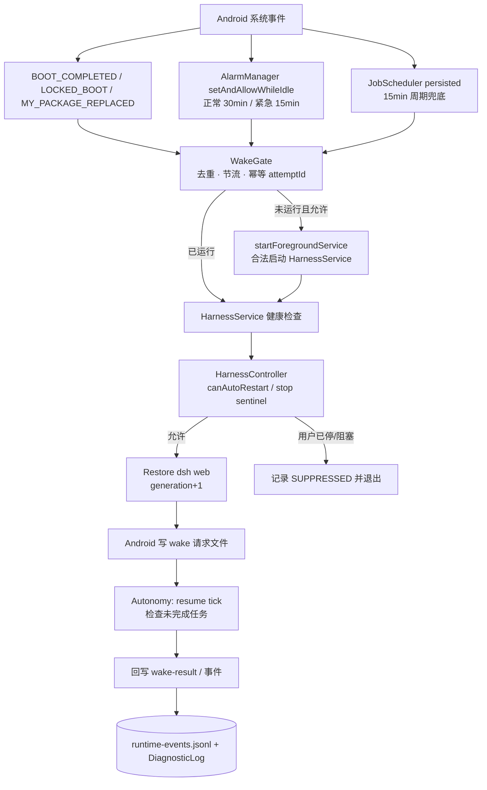

# ANDROID-REPORT-0001 · Android 平台负责人报告（DSHA 平台能力与后台恢复设计）

> 会话：Android 平台负责人（DSHA Android 平台专业智能体）
> 覆盖任务：`ANDROID-ARCH-AUDIT-01`（平台能力只读审计）、`ANDROID-BACKGROUND-RECOVERY-DESIGN-01`（后台唤醒与恢复设计）
> 迭代规则：**本文件覆盖式更新、版本号递增（ANDROID-REPORT-0002…），不新增同类文件**；与 `coordination/HANDOFF.md`、`coordination/REPORT.md` 同一目录。
> 最近更新：2026-11-21 02:45 (Asia/Shanghai) · v1 首次建档
> 性质：只读审计 + 只读设计。未改 DSHA 源码/Manifest/服务/配置/权限，未装包、未部署、未重启、未做 kill/reboot 实验、未申请新权限、未启动真实调度、未改生产库。

## 版本历史

| 版本 | 时间 | 覆盖任务 | 变更摘要 |
|---|---|---|---|
| v1 (ANDROID-REPORT-0001) | 2026-11-21 02:45 | ARCH-AUDIT-01 + BACKGROUND-RECOVERY-DESIGN-01 | 首次建档：平台基线、能力矩阵、权限矩阵、后台可靠性、多智能体条件、后台恢复设计与接口提案 |

---

## 0. 给 GPT 的阅读导航（先看这一节）

**需要 GPT 现在决策（§5.1）**
1. 接口方向：Android→DSH 单向文件 + Autonomy 回执预约，是否接受（现无 DSH→Android 通道）。
2. 唤醒精度：接受 15–30 分钟级（不能秒级）。
3. 事件日志落 `/root`（快、proot 内）还是 `/sdcard/DSHA/诊断/`（可读、FUSE 慢）。
4. P4 灰度顺序：先 alarm 健康检查，还是先 boot 自启。

**需要负责人授权（§5.2）**
1. 安装 DSHA **test 变体 APK**（隔离验证必需）。
2. 真机 **kill / reboot** 对照实验（验证 `START_STICKY` 与 vivo Freezer）。
3. 启动 staging（独立 profile/端口）。
4. 生产灰度与 `WakeScheduler` 开关。

**一句话结论**：DSHA 平台底座可用（无障碍/截图/剪贴板/传感器/文件/前台服务/Doze 白名单/Shizuku-ADB shell 均实测 PASS）；真正的缺口是**重启与进程死亡后的恢复链路**、**录音端点**、**内存余量**、**FUSE 上的 DB 写并发**，以及**生产仍在跑旧版记忆代码**。

---

## 1. 基线（本轮核对值）

| 对象 | 值 | 核对方式 |
|---|---|---|
| `ba-song/dsh-memory-core` main | `7548e49ed0b8d8673818464325d8e72ec7704b27` | `git ls-remote` 01:28 |
| 本文件所在分支 HEAD（建档前） | `c7401a7d4126a9f1aa373742b53e4e0cb8b05e45` | `git ls-remote` 02:40 |
| `coordination/HANDOFF.md` blob | `f8ffa40d4c27c04d23ff74b123bf2b7044821976` | `git ls-tree` |
| `coordination/REPORT.md` blob | `e219f707cc4363c53704fbe389f786148142326e` | 同上 |
| `dsh-persona-core` main / EI-1 | `a84c7bad…` / `92a763bf…` | `git ls-remote` |
| `dsh-autonomy` main | `6c4a4753b4737060211955b1f022cab2f1d39521` | 同上 |
| `DSH-APP/DSHA` main | `36d89b72294348d0482d509109cf8e76d51fc1cb` | `git ls-remote` |
| 设备本地插件镜像 | `b47fcc2e5148b8a179b11523804a4ff242c2a458`，工作树 clean | `git rev-parse` / `status` |
| 设备 / 系统 | vivo V2154A · Android 14 (SDK 34) · OriginOS 14.1 · SM8350 8 核 · RAM 11.1GB | `/app/device`、`getprop` |
| DSHA / DSH | `0.2.1-rc.2-20261022.2100`（code 190，minSdk 30，targetSdk 37）/ DSH `0.2.1-rc.2` | `/app/version` |
| 运行时 | Ubuntu 24.04.3 LTS arm64 · PRoot `libproot.so --link2symlink -0` · 伪 root（uid 10328，`CapEff=0`，`Seccomp=2`）· Node 24.19.0 · Python 3.12.3 · 内核 5.4.281-qgki | `ps`、`/proc/self/status` |

---

## 2. 平台能力审计（ANDROID-ARCH-AUDIT-01）

### 2.1 能力矩阵（实测结论）

| 能力 | 结论 | 关键证据 |
|---|---|---|
| 无障碍 UI | **PASS** | `accessibility_enabled=1`，DSHA 服务在列；`/app/ui/dump` 返回语义树；`/app/ui/screenshot` 1080×2400 / displayId 0 / `coordinatesAvailable:true` |
| 剪贴板读 | **PASS（仅前台）** | `/app/clip` 读成功；Android 10+ 后台不可读 |
| 传感器 | **PASS** | 37 个传感器；`light` 返回实时 31.79 lux |
| 文件系统 | **PASS** | `/sdcard` 可写，223G/107G 可用，inode 6% |
| 设备 shell | **PASS（uid2000）** | `id` = `uid=2000(shell)`；adbd running、USB `charging,adb`；Shizuku pid 13457 + `API_V23` 已授 |
| 位置 | **DISABLED（产品开关）** | `/app/location` → `DISABLED 位置能力未开启` |
| 录音 | **权限有、端点无** | `RECORD_AUDIO=true`；`/app/audio`、`/app/record` → `[NO_CMD]` |
| 虚拟屏 | **存在未运行** | `vscreen/status` = `STOPPED`，protocol 1；Android 14 满足 11+ |
| `/app/readfile` | **FAIL（文档/实现不一致）** | 对 `/sdcard/*` 一律 `FORBIDDEN` |
| 应用启动 / 通知 / 震动 / 分享 | 端点存在，**有副作用未执行（NOT RUN）** | Manifest 权限齐全；本轮遵守只读边界 |
| 短信 | **BLOCKED** | Manifest 未声明 SMS 权限；桥默认关闭；不得绕过 |
| 虚拟屏创建 / 录音 / 提权 / kill / reboot | **NOT RUN** | 本轮禁止 |

### 2.2 权限矩阵（`dumpsys package dsh.android.client`）

- **已授（20 项）**：`INTERNET`、`ACCESS_NETWORK_STATE`、`ACCESS_WIFI_STATE`、`CHANGE_WIFI_STATE`、`FOREGROUND_SERVICE`(+`SPECIAL_USE`/`DATA_SYNC`/`CONNECTED_DEVICE`)、`RECEIVE_BOOT_COMPLETED`、`WAKE_LOCK`、`VIBRATE`、`POST_NOTIFICATIONS`、`ACCESS_FINE/COARSE_LOCATION`、`RECORD_AUDIO`、`MODIFY_AUDIO_SETTINGS`、`QUERY_ALL_PACKAGES`、**`WRITE_SECURE_SETTINGS`**、`moe.shizuku.manager.permission.API_V23`。
- **未授**：`MANAGE_EXTERNAL_STORAGE=false`、`SYSTEM_ALERT_WINDOW=false`、`REQUEST_INSTALL_PACKAGES=false`。
- **未声明**：SMS、通讯录、相机、电话状态、身体传感器。
- **INCONCLUSIVE**：`/sdcard` 实测可全盘读写但 `MANAGE_EXTERNAL_STORAGE` 未授 → 疑 appops 单独放行；`appops`/`dumpsys appops` 被设备策略拦截（`POLICY_BLOCKED` 126），无法取得 appops 级证据。

### 2.3 后台与资源现状

- 进程 pid 22300，`mHasForegroundServices=true`、`curProcState=4`、后台时 `oom adj=100`、`cached=false`，连续运行 **1d14h+**。
- `mDeviceIdleWhitelist` **含 uid 10328**（Doze 豁免）。
- 内存：`MemTotal 11.6GB`、`MemAvailable 2.2–2.9GB`、`Swap 已用 6.5/8GB` → **并发最先崩点是内存**。
- 端口：3090/38105/9222/7897 **仅回环**；3081 LAN 网关对局域网开放；桥无 token 返回 `[UNAUTHORIZED]`。
- 多智能体：单 DSH 宿主（`node … bin.js web --host 127.0.0.1 --port 38105`），subagent 进程内运行，共享 `/root/.dsh` 与 `/sdcard`；memory.db 单写锁（12 路写实测 `appended 4–6`、`ELOCKED 6–8`，HANDOFF §19.3）。

### 2.4 风险与 BLOCKED（摘）

| # | 项 | 等级 | 状态 |
|---|---|---|---|
| R1 | 内存/交换紧张 | P0 | 风险 |
| R2 | Autonomy 定时全在进程内 | P0 | BLOCKED（无 Android 调度桥） |
| R3 | 短信 | — | BLOCKED（未声明权限） |
| R4 | 录音 | P1 | BLOCKED（接口缺失） |
| R5 | 位置 | P1 | BLOCKED（产品开关） |
| R6 | `/app/readfile` 对 `/sdcard` 全拒 | P2 | FAIL |
| R7 | `appops` 证据缺失 | P2 | BLOCKED（设备策略） |
| R8 | 重启自启 / 被杀恢复 | P1 | INCONCLUSIVE |
| R9 | LAN 网关 0.0.0.0:3081 + `lan-link.txt` 明文 token | P1 | 风险（建议纳入凭据管理） |
| R10 | 生产插件缺 exporter/permanent，P4 修复未进生产 | P0 | 事实（生产=部署树镜像，非上游 main） |

---

## 3. 后台唤醒与恢复设计（ANDROID-BACKGROUND-RECOVERY-DESIGN-01）

### 3.1 当前实现核查表

| # | 机制 | 状态 | 证据 |
|---|---|---|---|
| A1 | `HarnessService` FGS（`specialUse\|connectedDevice`） | 已实现且在跑 | `AndroidManifest.xml:246-251`；`HarnessService.java:29`；设备 pid 22300 |
| A2 | `START_STICKY` | 已实现 | `HarnessService.java:22/231/269` |
| A3 | 15s 心跳 + 3 次失败 + 120s 冷却 | 已实现 | `:47-49`、`:484-577` |
| A4 | WakeLock 600s + 每 15s 续期 + WifiLock + 策略放锁 | 已实现 | `:353-405`；设备 `'DSHA:web' DISABLED`（空闲放锁） |
| A5 | node 死亡自动拉起 | 已实现 | HTTP 探针 3s → `restartWebAutomatically` |
| A6 | `BootReceiver` | **已实现，但不恢复 DSH** | `BootReceiver.java:51-88` 仅启 DeviceBridge + 备份 + ADB 闹钟 |
| A7 | AlarmManager | 仅服务 ADB 桥（5min `setAndAllowWhileIdle`） | `AdbKeepAliveReceiver.java:22-33` |
| A8 | JobScheduler | 仅服务备份（persisted 15min） | `AutomaticBackups.java:49-69` |
| A9 | WorkManager | 未使用 | 全仓无 `androidx.work` |
| A10 | 精确闹钟 | 未声明/未使用 | 无 `SCHEDULE_EXACT_ALARM` |
| A11 | 给 Autonomy 的唤醒入口 | **不存在** | 仅 Autonomy 自身 60s `trigger:'resume'` |
| A12 | 去重/防重复启动 | 有（分散） | apply 查 current、kick 去抖、job 去重、alarm 同 PendingIntent |
| A13 | 退出/失败记录 | 部分 | `DiagnosticLog.java:14-36`、崩溃 `:67-89` |
| A14 | 未正常退出检测 | 有 | `ConfigStore.java:643` + `StartupRecoveryActivity` |
| A15 | 用户停止语义 | 有且强 | `STOP_SENTINEL`（`WebLifecycleController:1792/1917-1922`）+ `WebLifecycle:53-55` |
| A16 | 重启后恢复 DSH | **FAIL** | A6 + 进程启动晚于开机约 0.8 天（elapsed） |
| A17 | 进程被杀恢复 | **INCONCLUSIVE** | 依赖 START_STICKY；未做 kill 实验 |
| A18 | 被 vivo 冻结 | **INCONCLUSIVE** | `dumpsys power` 出现 `mIsFrozen`；无对照实验 |
| A19 | 现有 Android↔DSH 契约 | **已存在（反向）** | `app/src/main/assets/app-integration/index.js:16-50` 每 2s 原子写 `/root/.dsha-web-activity.json` |

**关键发现**：A19 是唯一已落地、可扩展的 Android↔DSH 文件契约（DSH 写 / Android 读），接口设计应顺着它扩展，而不是另造 IPC。

### 3.2 推荐架构

比较六方案后推荐**组合**：现有 FGS + 心跳（保留）+ **AlarmManager 兜底**（新增，只做检查）+ **JobScheduler persisted**（新增/复用，跨重启兜底）+ **BOOT_COMPLETED 启动 Harness**（新增，受 stop sentinel 门控）。



**为什么这样选**：不新增任何权限（不要 `SCHEDULE_EXACT_ALARM`、不引 WorkManager）；Alarm 只当外部时钟不做保活；JobScheduler 解决 OEM 拦 boot 广播的兜底。目标是把「被杀后恢复」从**永不**变成**分钟级**，不承诺永不被杀。

**平台依据**（官方文档）：后台启动 FGS 的豁免包含「用户关闭电池优化」「BOOT_COMPLETED 接收器」「精确闹钟」「SYSTEM_ALERT_WINDOW（Android 15 起需可见悬浮窗）」；Android 15 对 `BOOT_COMPLETED` 启动 FGS 的限制类型为 `dataSync/camera/mediaPlayback/phoneCall/mediaProjection/microphone`，**`specialUse`、`connectedDevice` 不在受限列表**（本机 Android 14，该限制尚未适用）。

### 3.3 唤醒与恢复流程

```
① 系统事件（boot / alarm / job / 用户）
② WakeGate：attemptId=hash(bootId+reason+window)；同窗口只一次；<10min 直接 THROTTLED；低内存 DEFERRED
③ 检查运行时：已在 → 健康检查；不在 → startForegroundService（失败记 WAKE_START_DENIED，不换通道、不重放）
④ HarnessService 恢复：canAutoRestart() = !restoreUnknown && !recovery.blocked && canAutoStart(sentinel)
   不满足 → SUPPRESSED_USER_STOPPED / RESTART_BLOCKED / RESTORE_UNKNOWN
⑤ 拉起 dsh web（generation+1）：沿用现有 3 次 + 120s 冷却
⑥ Android 写 /root/.dsha-wake.json
⑦ Autonomy 启动后读取 → tick({trigger:'resume'}) → 检查未完成任务（继续/等待/放弃，不重做）→ 回写 result
⑧ 记录：DiagnosticLog + /root/.dsha-runtime-events.jsonl
```

关键规定：force-stop **不可恢复**（包 stopped、广播不达、job 取消，只能提示手动打开）；用户点「停止」→ sentinel 永久阻断直到手动启动；Doze 延迟只记录不补偿；唤醒频率硬下限 10min。

### 3.4 Android ↔ Autonomy 接口提案

**原则**：Android 只写事件/请求，不改 Autonomy 任务库；任务判定权在 Autonomy；幂等、可追踪、可恢复。

文件契约（原子 rename、`0600`、schema 版本）：
- `/root/.dsha-wake.json`：`{schema, attemptId, bootId, reason(boot|alarm|job|user_open|recovery), requestedAt, notBefore, deadline, generation, mode(check|restore|recovery)}`
- `/root/.dsha-wake-result.json`：`{schema, attemptId, result(accepted|rejected|deferred|done), errorCode, at, autonomy:{resumeTick, pendingTasks}}`
- `/root/.dsha-runtime-events.jsonl`：追加式单行 JSON，2MB 轮转 1 份
- 扩展现有 `/root/.dsha-web-activity.json`：**只加字段**（`runtimeId`、`autonomy`），不改语义；Android 现为逐字段读取（`HarnessService:447-451`），向后兼容

Java 侧（DSHA 内部）：
```java
WakeRequest requestWake(String reason, long notBefore, long deadline, String mode);
void cancelWake(String attemptId);
void onRuntimeStarted(String bootId, long runtimeId, long generation);
void onRuntimeStopping(String reason);
void reportWakeResult(String attemptId, WakeResult result, String errorCode);
void requestRecovery(String reason, CheckpointRef checkpoint);
```
> 未照搬 GPT 给的 5 个名字：Android 侧 `requestWake` 是「排一次唤醒」，事件回调用 `onRuntimeStarted/onRuntimeStopping`，文件层用 wake/result/events 三件套更贴合现有 `app-integration` 风格。

### 3.5 资源与可靠性参数

| 参数 | 建议 |
|---|---|
| 进程内心跳 | 15s（保持现状） |
| 自动重启冷却 / 失败阈值 | 120s / 3 次（保持） |
| Alarm 间隔 | 正常 30min · 紧急 15min · 空闲 60min |
| 唤醒硬下限 | 10min |
| 失败退避 | 1/2/4/8/16/32/60min（上限 60） |
| 24h 唤醒上限 | 48 次（超限只做健康检查） |
| 重型任务并发 | ≤2 subagent + ≤1 Chromium |
| 低内存 | `MemAvailable<1.5GB` 跳过新任务；`<1.0GB` 只健康检查 |
| 唤醒后启动 | single-flight + 10min 冷却 + 串行队列 |

### 3.6 失败场景与恢复策略

| 场景 | 处理 | 错误码 | 重试 |
|---|---|---|---|
| 唤醒时进程不在 | `startForegroundService` | — | 是（退避） |
| 后台启动 FGS 被拒 | 记录 + 退避，不换通道 | `WAKE_START_DENIED` | 是 |
| 用户 force-stop | 提示手动打开 | `IRRECOVERABLE_USER_FORCE_STOP` | 否 |
| 用户点停止 | 不启动 | `SUPPRESSED_USER_STOPPED` | 否 |
| 连续失败已阻塞 | 不启动，提示恢复页 | `SUPPRESSED_RESTART_BLOCKED` | 否 |
| 会话状态未知 | 不自动启动 | `SUPPRESSED_RESTORE_UNKNOWN` | 否 |
| dsh web 起不来 | 现有 3 次 + 120s | `RESTORE_FAILED` | 是 |
| Doze 延迟 | 记录 delayMs，不补偿 | `WAKE_DELAYED` | 否 |
| 断网 | 进程保持，任务退避 | `NETWORK_UNAVAILABLE` | 是（Autonomy 侧） |
| 低内存 | 降级只检查 | `DEFERRED_LOW_MEMORY` | 下次 |
| 存储不足 | 不启动重任务 | `STORAGE_LOW` | 下次 |
| 电池优化被撤销 | 提示设置路径 | `PERMISSION_BATTERY` | 是 |
| OEM 拦自启 | 记录等用户打开 | `BOOT_SUPPRESSED_OEM` | 否 |
| 重复唤醒 | 丢弃 | `DEDUPED` | 否 |
| 唤醒风暴 | 退化为健康检查 | `THROTTLED_DAILY` | 否 |

### 3.7 分阶段实施计划与授权门槛

| 阶段 | 内容 | 授权门槛 |
|---|---|---|
| P0 源码开发 | DSHA 分支：`WakeScheduler` + Boot 启动 Harness + 文件契约 + 事件日志 | GPT 分配分支；不改生产源码、不合并 main |
| P1 模拟测试 | Robolectric/仪器测试：boot/alarm 触发、去重、退避、sentinel 门控、force-stop 语义 | 无（本地可跑） |
| P2 隔离验证 | 装 **test 变体 APK**（不同 applicationId 后缀），真实 boot/alarm 验证 | **负责人授权安装测试包** |
| P3 staging | 独立 profile + 端口 31873 + 独立 DSH_HOME，端到端验证唤醒→resume | **负责人授权启动 staging** |
| P4 生产灰度 | 先只开 alarm 健康检查（不自动启动），24h 后再开 boot 自启 | **负责人逐项授权** |

回滚：`WakeScheduler.enabled=false` 即停调度，事件日志保留；P0–P2 只影响测试包。

### 3.8 未验证 / INCONCLUSIVE

| 项 | 状态 | 原因 |
|---|---|---|
| kill 后 `START_STICKY` 是否真被重启 | NOT RUN | 本轮禁止 kill 实验 |
| vivo 是否因「电池优化白名单」放行后台启动 FGS | INCONCLUSIVE | 文档说放行，但 DSHA 自身仍在捕获 `IllegalStateException`（`DeviceBridgeService.java:130-140`），说明现实中会遇到拒绝 |
| vivo Freezer 是否冻结 DSHA、是否停 node | INCONCLUSIVE | 出现 `mIsFrozen`，当前 `isFrozen=false`，无对照实验 |
| BootReceiver 是否被 OEM 拦截 | NOT RUN | 需真机重启实验 |
| JobScheduler 备份任务当前是否在跑 | INCONCLUSIVE | `dumpsys jobscheduler` 被策略拦截 |
| force-stop 真实表现 | INCONCLUSIVE | 结论来自官方语义，未实测 |
| 事件日志对 `/sdcard` FUSE 的写放大 | NOT RUN | 未做基准 |

---

## 4. 证据索引

### 4.1 源码（`DSH-APP/DSHA` @ `36d89b7`）

| 文件 | 行 | 内容 |
|---|---|---|
| `app/src/main/java/com/deepseekharness/app/BootReceiver.java` | 51-88 | 只启 DeviceBridge + 备份 + 闹钟 |
| `.../HarnessService.java` | 19-28, 47-49, 199-270, 353-405, 484-577, 608-640, 436-455 | FGS/心跳/重启/WakeLock/健康判定/活动文件读取 |
| `.../AdbKeepAliveReceiver.java` | 22-33, 54-64 | 5min `setAndAllowWhileIdle`，仅 ADB |
| `.../DeviceBridgeService.java` | 86-88, 112-160, 228-253, 361-365 | 看门狗周期/退避、后台启动失败处理 |
| `.../backup/AutomaticBackups.java` | 49-69 | `JobScheduler.setPersisted(true).setPeriodic(15min)` |
| `.../core/WebLifecycleController.java` | 860-866, 878-895, 1917-1922, 1936-1948 | `startWeb`、`requiresRuntimeProtection`、sentinel、`canAutoRestart` |
| `.../util/WebLifecycle.java` | 53-55 | `canAutoStart` 四条件 |
| `.../core/DiagnosticLog.java` | 14-36, 67-89 | 有界诊断日志、崩溃记录 |
| `.../core/ConfigStore.java` | 643 | `isStartupRecoveryRequested` |
| `app/src/main/assets/app-integration/index.js` | 16-50 | 现有 Android↔DSH 心跳契约 |
| `app/src/main/AndroidManifest.xml` | 14-40, 246-251, 268-285 | 权限、HarnessService、BootReceiver/AdbKeepAlive |

### 4.2 设备证据（2026-11-21 02:19–02:30）

| 证据 | 值 |
|---|---|
| `/app/device` | android=14、battery=76%、charging=true、`app_foreground=false`、`memory_free=2.24GB` |
| `dumpsys activity processes` | pid 22300、`oom adj cur=100`、`curProcState=4`、`mHasForegroundServices=true`、`cached=false`、运行 1d14h47m |
| `dumpsys power` | `mDeviceIdleWhitelist` 含 10328；`'DSHA:web' DISABLED … mIsFrozen`；`'DSHA:runtime-task'` 短持有 |
| `dumpsys package` | BootReceiver 三 action；HarnessService FGS type；`MANAGE_EXTERNAL_STORAGE=false` |
| `/root/.dsha-web-activity.json` | `{"generation":"7","at":…,"idle":false,"plugins":[]}`（DSH 侧 2s 写，证明契约在跑） |
| Autonomy 运行时 | `stage=offline-mock-only`、`tickEnabled=false`、6 executor 全 mock |

### 4.3 平台文档（外部）

- [前台服务后台启动限制与豁免](https://developer.android.com/develop/background-work/services/fgs/restrictions-bg-start)
- [Android 15 BOOT_COMPLETED 启动 FGS 限制](https://developer.android.com/about/versions/15/behavior-changes-15)
- [Android 14 前台服务类型必填](https://developer.android.com/about/versions/14/changes/fgs-types-required)

---

## 5. 决策与授权请求

### 5.1 需 GPT 裁决
1. **接口方向**：Android→DSH 单向（文件）+ Autonomy 在回执里预约下一次，Android 据此调 alarm；是否需要 DSH→Android 主动通道（当前骨架没有）。
2. **唤醒精度**：15–30 分钟级是否可接受。
3. **事件日志位置**：`/root/.dsha-runtime-events.jsonl`（快，proot 内）vs `/sdcard/DSHA/诊断/`（可读，FUSE 慢）。
4. **P4 灰度顺序**：先 alarm 健康检查 vs 先 boot 自启。
5. **`pendingTasks` 语义**：需 Autonomy 智能体先定义（goal/action/reflection 三类），Android 只传数字。

### 5.2 需负责人授权
1. 安装 DSHA **test 变体 APK**（P2）。
2. 真机 **kill / reboot** 对照实验（验证 A17/A18）。
3. 启动 staging（P3）。
4. 生产灰度与 `WakeScheduler` 开关（P4）。
5. 是否把「电池优化白名单」作为长期依赖（用户撤销后会退化）。

### 5.3 与其它领域的接口冲突
- 与 Autonomy：`pendingTasks` 定义、resume tick 语义（只检查不重做）需与 Autonomy 智能体对齐；Android 不解释任务语义。
- 与 Memory：事件日志不写记忆库；是否进入 permanent archive 由 Memory 决定。
- 与 DSH/DSH-ISOLATION：P3 staging 端口 31873、独立 profile 需与 DSH 的 staging 方案一致。

---

## 6. 边界声明

本轮只读：未修改 DSHA 源码、Manifest、服务、配置、权限；未安装 APK、未部署、未重启；未执行 kill/reboot；未申请新权限；未启动真实后台调度；未修改生产数据库；未修改 `coordination/HANDOFF.md`、`coordination/REPORT.md`、`PROJECT.md`；未修改 Autonomy 接口。
